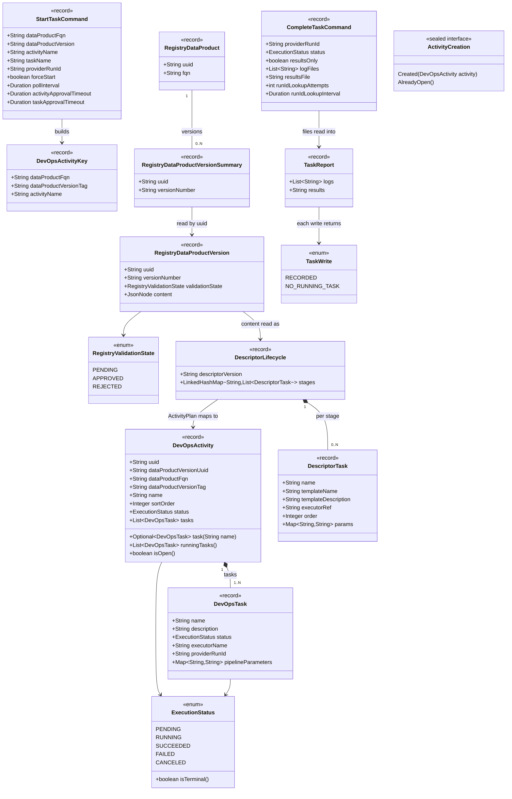

# DevOps V2 CLI commands: `platform devops start-task` and `complete-task`

Source analysis: `spdd/analysis/BDMD-5443-202610261616-[Analysis]-devops-v2-cli-commands.md` (revision 7). The decisions referenced below as DD-xx and Qxx are defined there. The Docker image is out of scope.

## Requirements

- **Let a CI pipeline run an instrumented DevOps V2 task under platform governance.** One command, `start-task`, brings the task to `RUNNING`. It finds the open activity, or creates it from the published Registry descriptor. It then waits for policy approval, requests the task with the pipeline's run id, and waits for the task's approval. A second command, `complete-task`, closes the task: it uploads logs and results, then records the terminal status.
- **Let a full-control pipeline upload its results** with `complete-task --results-only`, addressing its task by its own run id. No coordinates are needed.
- **Make every failure explicit to the pipeline:**
  - exit `0` on success;
  - exit `1` when a command fails;
  - exit `2` on invalid usage.
  - The last log line names the step that failed and the cause. DevOps refusals are shown verbatim.
- **Run only published versions unless an operator forces it.** A version that is not `APPROVED` in Registry is refused unless `--force-start` is passed. The same flag replaces an open activity that can no longer accept the task.
- **Boundaries:**
  - **CLI-side only.** The CLI never re-implements DevOps rules (ordering, concurrency, modes, `RUNNING` checks).
  - **Instrumented tasks only.** It never builds full-control executor parameters or sends secrets.
  - **No state between commands.** It keeps no state file and reads no CI environment variables.
  - **DevOps prerequisite.** `complete-task` depends on run-id addressing in DevOps (DD-17). That change is implemented in `odm-platform-pp-devops-server`, not here.

## Entities



Placement and ownership:
- **DevOps client domain types:** `DevOpsActivityKey`, `DevOpsActivity`, `DevOpsTask` and `ExecutionStatus` live in `clients/platform/devops`. This follows the existing pattern of `DataProductValidationResults` in the Registry client.
- **Registry client domain types:** `RegistryDataProduct`, `RegistryDataProductVersionSummary`, `RegistryDataProductVersion` and `RegistryValidationState` live in `clients/platform/registry`.
- **`start-task` unit types:** `DescriptorLifecycle`, `DescriptorTask` and `ActivityCreation` belong to the unit (`usecases/devops/starttask`). One unit uses them, so they are not shared.
- **`complete-task` unit types:** `TaskWrite` and `TaskReport` belong to `usecases/devops/completetask`.
- **No shared `domain` package:** only two units exist, so sharing is not earned (PROGRESSIVE_DISCOVERY rule 4).
- **Existing types are unchanged.** `PlatformServiceCredentials` is reused for `cli.platform.services.devops`. `DataProductValidationResults` and the V1 validate call stay as they are.

## Approach

1. **Command surface (DD-02, DD-03, DD-09, DD-10):**
   - **Command group.** A new `devops` group attaches to `platform` the way `registry` does (a `PicoCliCommandBuilder` bean whose parent is `platform`). It has two subcommands, `start-task` and `complete-task`.
   - **Options.** Every input is an explicit picocli option. Required options are declared `required(true)`, so a missing value is picocli usage, exit `2`. The commands never prompt: they do not override `handleRequiredOptions` and never call `System.console()`.
   - **Value converter.** One picocli converter rejects empty values and values that are still unresolved CI references (`${…}`, `$NAME`, `$(…)`) on every coordinate and on the run id, so the rejection is a usage error with exit `2` (DD-06).
   - **`--status` and `--results-only`.** They sit in an exclusive, required argument group, so passing both or neither is exit `2` (Q18).
2. **Use case slices (USE_CASE_IMPLEMENTATION, PROGRESSIVE_DISCOVERY):**
   - **Shape.** Each command runs one use case: command executor → factory → use case → ports → presenter. This is the shape of `DescriptorValidator`.
   - **Module.** The two units form the module `usecases/devops`. It has:
     - an index README;
     - an L0 README per unit;
     - a structure test;
     - a README guard.
   - **Step classes.** Each unit has steps with three or more rules, so those steps are step classes.
   - **Policy versus mechanics:**
     - **Policy, in the use cases and their steps:** get-or-create, the publication check, the force-start replacement, the waits, the upload order, and the run-id not-found retry.
     - **Mechanics, in the ports and clients:** HTTP, JSON parsing, file reads, and the 409 retry.
3. **Remote systems (INTEGRATIONS, DD-08, DD-14):**
   - **DevOps client.** A new `PlatformDevOpsClient` with an implementation and a lazy factory, built like the Registry client: `RestUtilsFactory.getAuthenticatedRestUtils` and the `cli.platform.services.devops {url, headers, oauth2}` configuration. `url` is the base address only; the client owns the route `/api/v2/pp/devops/activities`.
   - **Registry client.** `PlatformRegistryClient` gains three V2 lookups next to the V1 validate call: products by FQN, versions by product and version number, and a version by uuid. They use `V1_ROUTE` and `V2_ROUTE` constants, and the blueprint server's `getPage(Pageable.ofSize(2))` duplicate detection.
   - **Error translation, inside both clients** (DD-07). `ClientException` is read as the platform error body `{status, error, message, path}`:

     | Response | Translated to |
     | --- | --- |
     | 400 | `BadRequestException(server message)` |
     | 404 | `NotFoundException(server message)` |
     | 409 | Retried a bounded number of times, then `ResourceConflictException` |
     | Transport failure (no HTTP response) | `InternalException("Could not reach the ODM Platform <service> service: …")` |
     | Anything else, or an unreadable body | `InternalException("ODM Platform <service> service failed (HTTP n): …")` |

     A body that is not JSON is summarised as `unexpected non-JSON response (<HTML or XML|text>, <n> characters)`, never echoed. The translated exceptions carry no `ClientException` cause, so the CLI never prints the raw `{code=…, responseBody='…'}`, not even in a stack trace. A 409 with an unreadable body still becomes `ResourceConflictException`, with a generic message.
   - **409 retry.** It is safe because a serialization conflict rolls the transaction back. Attempts and interval are configuration. Only the DevOps client retries; a Registry 409 is translated without retry.
4. **Business logic, `start-task`** (DD-04, DD-05, DD-11, DD-13, DD-16, Q6):
   - **Procedure:** obtain the activity → wait for activity approval → request the task → wait for task approval → present.
   - **Obtaining the activity:**
     1. Search for open activities by the natural key (`PENDING`, `RUNNING`, page size 2).
     2. If one is found and it is blocked for the requested task, apply the force-start policy.
     3. If none is open: look up the version in Registry, check the publication state, plan the activity from the descriptor, and execute it.
     4. If DevOps answers "already PENDING or RUNNING" (a concurrent run), search again and reuse what it finds.
   - **Waits.** Both waits read the activity by uuid every `pollInterval` until the target state, a terminal outcome or the timeout. A timeout writes nothing to DevOps.
5. **Business logic, `complete-task`** (DD-12, DD-17, Q18, Q19):
   - **Checks first.** Every local input is checked before any call.
   - **Instrumented mode:** logs → results → status. A failed results upload records `FAILED`; a failed logs upload records the requested status. The command still exits `1` in both cases.
   - **Full control (`--results-only`):** results only.
   - **Addressing.** Every write is addressed by `providerRunId` alone. When DevOps finds no `RUNNING` task with that id, the write is retried `runIdLookupAttempts` times at `runIdLookupInterval` (default 5 × 2 s), then fails, naming the id.
   - **Lookup exhausted once, for the whole command.** No later write can find the task either, so the later writes fail at once without calling DevOps. The status write is skipped, and the command fails at the step where the lookup first ran out.
6. **Exceptions and exit codes:**
   - **No `GlobalExceptionHandler`.** The CLI has no HTTP edge. `PicoCliCommandExecutor.call()` is the single error edge: it logs `Failed to execute command, cause: <message>` and returns exit `1`.
   - **Use cases** raise `UseCaseException` and hand every failure to the presenter, whose `UseCasePresenter` defaults throw the CLI's API exceptions up to that edge.
   - **Exit `2`** comes only from picocli parsing and conversion.
7. **Risks addressed:**
   - **Interactive default** (DD-10): no prompting.
   - **Raw error bodies** (DD-07): translated in the clients.
   - **Key order of `lifecycleInfo`:** read as an `ObjectNode`, which keeps the key order.
   - **Two copies of the mapping:** the UI's test cases (BDMD-5518) are ported as fixtures.
   - **Fragile matching of the race refusal:** one constant, one test.
   - **`--force-start` closing a live run:** documented as an operator override.

## Structure

### Inheritance Relationships
1. **`DevOpsCommandBuilder`, `StartTaskCommandBuilder`, `CompleteTaskCommandBuilder`** implement `PicoCliCommandBuilder`.
2. **`DevOpsCommandExecutor`, `StartTaskCommandExecutor`, `CompleteTaskCommandExecutor`** extend `PicoCliCommandExecutor`.
3. **`ResolvedValueConverter`** implements `CommandLine.ITypeConverter<String>`. **`TaskStatusConverter`** and **`DurationConverter`** implement `ITypeConverter` for `ExecutionStatus` and `Duration`.
4. **`StartTask` and `CompleteTask`** implement `UseCase`. Both are package-private.
5. **`StartTaskPresenter` and `CompleteTaskPresenter`** extend `UseCasePresenter`.
6. **`PlatformDevOpsClientImpl`** implements `PlatformDevOpsClient` (package-private). **`PlatformRegistryClientImpl`** keeps implementing the extended `PlatformRegistryClient`.
7. **`ActivityCreation`** is a sealed interface with the records `Created` and `AlreadyOpen`.
8. **Exceptions:** no new types. The existing `BadRequestException`, `NotFoundException`, `ResourceConflictException` and `InternalException` (all extending `OdmCliApiException`) and `UseCaseException` are reused.

### Dependencies
1. **`DevOpsCommandBuilder`** collects the `PicoCliCommandBuilder` beans whose parent is `devops`.
2. **`StartTaskCommandBuilder`** injects `OdmCliConfiguration` and `StartTaskFactory`. **`CompleteTaskCommandBuilder`** injects `OdmCliConfiguration` and `CompleteTaskFactory`.
3. **`StartTaskFactory`** (`@Component`) injects `PlatformDevOpsClientFactory` and `PlatformRegistryClientFactory`, and creates with `new`:
   - `StartTaskDevOpsOutboundPortImpl`;
   - `StartTaskRegistryOutboundPortImpl`, given a supplier of the Registry client rather than the client;
   - `StartTaskDescriptorOutboundPortImpl`;
   - `StartTaskClockOutboundPortImpl`.
4. **`CompleteTaskFactory`** (`@Component`) injects `PlatformDevOpsClientFactory` and `ObjectMapper`, and creates with `new`:
   - `CompleteTaskDevOpsOutboundPortImpl`;
   - `CompleteTaskFilesOutboundPortImpl`;
   - `CompleteTaskClockOutboundPortImpl`.
5. **`StartTask`** depends on its four ports and its step classes `OpenActivity`, `VersionLookup`, `ActivityPlan` and `Approval`. The step classes depend only on unit types, client domain types and the JDK.
6. **`CompleteTask`** depends on its three ports and the step class `TaskReportCheck`.
7. **`PlatformDevOpsClientFactory`** (`@Component`) injects `RestTemplate` and `OdmCliConfiguration`. **`PlatformRegistryClientFactory`** is unchanged, apart from the blank-`url` check.

### Layered Architecture
1. **Command layer** (`commands/platform/devops/**`): option parsing, conversion and usage errors; building the use case command; the presenter that logs progress and outcome. The group builder and the converters sit in `commands/platform/devops`; each command's builder and executor sit in `commands/platform/devops/{starttask,completetask}`, mirroring `registry/validate`.
2. **Use case layer** (`usecases/devops/{starttask,completetask}`):
   - **L1:** `execute()`.
   - **L2:** the step classes.
   - **L3:** the rules, as private methods at the bottom of each step class.
3. **Port layer (L4):** the `*OutboundPortImpl` classes. They map client outcomes to unit types and read files and JSON. They make no decisions.
4. **Client layer** (`clients/platform/{devops,registry}`): HTTP, wire resources (`resources/`), error translation and the 409 retry.
5. **Configuration** (`configs/platform`): `PlatformServices.devops` (credentials) and `PlatformConfiguration.devops` (command timings).
6. **Error edge:** `PicoCliCommandExecutor.call()` (exit `1`) and picocli parsing (exit `2`).

## Operations

Execution order: 1 → 2 → 3 → 4 → 5 → 6 → 7 → 8 → 9 → 10 → 11 → 12.

### 1. Update Configuration - `PlatformServices`, `PlatformConfiguration`, `DevOpsCommandsConfiguration`, `application.yml`
1. Responsibility: typed configuration for the DevOps service and the command timings.
2. Attributes:
   - **`PlatformServices.devops`** (`PlatformServiceCredentials`): `url`, `headers`, `oauth2`, the same shape as `registry`.
   - **`PlatformConfiguration.devops`** (new class `configs/platform/DevOpsCommandsConfiguration`):
     - `pollInterval`: `Duration`, default `5s`;
     - `activityApprovalTimeout`: `Duration`, default `30m`;
     - `taskApprovalTimeout`: `Duration`, default `10m`;
     - `runIdLookupAttempts`: `int`, default `5`;
     - `runIdLookupInterval`: `Duration`, default `2s`;
     - `conflictRetries`: `int`, default `3`;
     - `conflictRetryInterval`: `Duration`, default `1s`.
3. `application.yml`:
   - Add `cli.platform.devops` with the defaults above. They are safe everywhere, so they may be packaged.
   - Do **not** add `cli.platform.services.devops.url`: it is environment-specific.
4. Constraints: JavaBeans with getters and setters, bound by the existing `@ConfigurationProperties(prefix = "cli")`. Field initialisers carry the defaults too, so a missing `devops` block still works.

### 2. Update Client - `PlatformRegistryClient` (Registry V2 lookup, DD-14)
1. Responsibility: add the V2 version lookup next to V1 validate, and translate errors.
2. New methods on the interface:
   - **`List<RegistryDataProduct> findDataProductsByFqn(String fqn)`:**
     - `GET {url}/api/v2/pp/registry/products?fqn=…&page=0&size=2&sort=` through `getPage(…, Pageable.ofSize(2), new RegistryDataProductSearchOptions(fqn), RegistryDataProductRes.class)`.
     - Returns the page content mapped to domain records, at most 2.
   - **`List<RegistryDataProductVersionSummary> findDataProductVersions(String dataProductUuid, String versionNumber)`:** `GET {url}/api/v2/pp/registry/products-versions?dataProductUuid=…&versionNumber=…&page=0&size=2&sort=`.
   - **`RegistryDataProductVersion getDataProductVersion(String uuid)`:**
     - `GET {url}/api/v2/pp/registry/products-versions/{uuid}`.
     - Maps `uuid`, `versionNumber`, `validationState` and `content`.
     - An unknown `validationState` value fails mapping with `InternalException`.
3. Implementation, `PlatformRegistryClientImpl`:
   - Constants: `V1_ROUTE = "/api/v1/pp/registry"`, `V2_ROUTE = "/api/v2/pp/registry"`. The existing validate path uses `V1_ROUTE + "/validate/report"`.
   - Wire resources, in `clients/platform/registry/resources/`:
     - `RegistryDataProductRes {uuid, fqn}`;
     - `RegistryDataProductVersionShortRes {uuid, dataProductUuid, versionNumber, validationState}`;
     - `RegistryDataProductVersionRes {uuid, versionNumber, validationState, content: JsonNode}`;
     - `RegistryDataProductSearchOptions {fqn}`;
     - `RegistryDataProductVersionSearchOptions {dataProductUuid, versionNumber}`.
     - Every field of a search-options class becomes a query parameter, so they declare only these fields. All are `@JsonIgnoreProperties(ignoreUnknown = true)`.
   - `translate(ClientException)` and `translate(ClientResourceMappingException)` are private methods at the bottom. They read the error body as `{message}` and apply the table in Approach 3, with the service named `registry`. The existing validate call keeps its current `InternalException` messages.
4. `PlatformRegistryClientFactory`: also throw `IllegalStateException("Missing configuration for odm-platform registry service: cli.platform.services.registry.url")` when `url` is blank.
5. Constraints:
   - The client makes no not-found or ambiguity decisions: it returns lists.
   - Never log headers or bodies.

### 3. Create Client - `PlatformDevOpsClient` (`clients/platform/devops`)
1. Responsibility: the only code that knows the DevOps V2 paths, payloads and errors.
2. Domain types in the same package:
   - `DevOpsActivityKey`;
   - `DevOpsActivity`, with `task(name)`, `runningTasks()` and `isOpen()` (status `PENDING` or `RUNNING`). These methods read only its own fields;
   - `DevOpsTask`;
   - `ExecutionStatus`, with `isTerminal()`.
3. Methods (base path `{url}/api/v2/pp/devops/activities`):
   - **`List<DevOpsActivity> findOpenActivities(DevOpsActivityKey key)`:** `GET ?dataProductFqn=…&dataProductVersionTag=…&name=…&statuses=PENDING,RUNNING&page=0&size=2&sort=`, through `getPage` with `DevOpsActivitySearchOptions {dataProductFqn, dataProductVersionTag, name, statuses}`, where `statuses` is the string `"PENDING,RUNNING"`. Search results carry no tasks, so `tasks` is an empty list.
   - **`DevOpsActivity getActivity(String uuid)`:** `GET /{uuid}`, the full graph with tasks.
   - **`DevOpsActivity executeActivity(DevOpsActivity plan)`:**
     - `POST /execute` with body `{activity: {dataProductVersionUuid, dataProductFqn, dataProductVersionTag, name, sortOrder, tasks: [{name, description, executorName, pipelineParameters}]}}`.
     - Returns the `activity` of the 201 response.
     - Sends no secret headers.
   - **`DevOpsActivity requestTaskExecution(DevOpsActivityKey key, String taskName, String providerRunId)`:** `POST /tasks/request-execution` with body `{dataProductFqn, dataProductVersionTag, activityName, taskName, providerRunId}`.
   - **`DevOpsActivity cancelActivity(String uuid)`:** `POST /cancel` with body `{activity: {uuid}}`.
   - **`void recordTaskStatus(DevOpsActivityKey key, String taskName, ExecutionStatus status)`:** `POST /tasks/status` with body `{dataProductFqn, dataProductVersionTag, activityName, taskName, status}`. Used only by force-start.
   - **`void recordTaskLogsByRunId(String providerRunId, List<String> logs)`:** `POST /tasks/logs` with body `{providerRunId, logs: [{content}]}`.
   - **`void recordTaskResultsByRunId(String providerRunId, String results)`:** `POST /tasks/results` with body `{providerRunId, results: [{content}]}`.
   - **`void recordTaskStatusByRunId(String providerRunId, ExecutionStatus status)`:** `POST /tasks/status` with body `{providerRunId, status}`.
4. Wire resources, in `clients/platform/devops/resources/`:
   - `DevOpsActivityRes`;
   - `DevOpsTaskRes`;
   - `DevOpsTaskTextRes {content}`;
   - `DevOpsActivityEnvelopeRes {activity}`;
   - `DevOpsTaskCommandRes`: one class with the nullable fields `providerRunId`, `dataProductFqn`, `dataProductVersionTag`, `activityName`, `taskName`, `status`, `logs` and `results`, serialized with `@JsonInclude(NON_NULL)`;
   - `DevOpsActivitySearchOptions`;
   - `DevOpsErrorRes {status, error, message, path}`.

   Field names are taken from `odm-platform-pp-devops-server` `rest/v2/resources`. All resources are `@JsonIgnoreProperties(ignoreUnknown = true)`.
5. Error handling: every call goes through a private `call(String operation, Supplier<T>)`:
   - On `ClientException` 409, it retries up to `conflictRetries` times, sleeping `conflictRetryInterval`.
   - It then translates the error per Approach 3, naming the service `devops`. The 400 message is the server's `message`, verbatim.
6. **`PlatformDevOpsClientFactory`** (`@Component`): throws `IllegalStateException("Missing configuration for odm-platform devops service: cli.platform.services.devops.url")` when `devops` or its `url` is missing. It passes the `RestTemplate`, the credentials and `DevOpsCommandsConfiguration` to the implementation.
7. Logging: DEBUG per call, with the method, path and identifiers (uuid, FQN, run id). No headers, no bodies.

### 4. Create Use Case - `StartTask` (`usecases/devops/starttask`)
1. Files:
   - `StartTask` (package-private);
   - `StartTaskCommand`;
   - `StartTaskPresenter`;
   - `StartTaskStep` (public, because the presenter's methods take it; enum: `FIND_ACTIVITY`, `REPLACE_ACTIVITY`, `LOOK_UP_VERSION`, `PLAN_ACTIVITY`, `EXECUTE_ACTIVITY`, `AWAIT_ACTIVITY_APPROVAL`, `REQUEST_TASK`, `AWAIT_TASK_APPROVAL`);
   - `StartTaskFactory`;
   - the ports `StartTaskDevOpsOutboundPort`, `StartTaskRegistryOutboundPort`, `StartTaskDescriptorOutboundPort` and `StartTaskClockOutboundPort`, and their `*Impl` classes;
   - the step classes `OpenActivity`, `VersionLookup`, `ActivityPlan` and `Approval`;
   - the unit types `DescriptorLifecycle`, `DescriptorTask` and `ActivityCreation`;
   - `README.md` (L0).
2. Presenter (`StartTaskPresenter extends UseCasePresenter`):
   - `presentProgress(StartTaskStep step, String detail)`;
   - `presentPoll(StartTaskStep step, String detail)`: a default no-op method, called on every poll;
   - `presentWarning(String message)`;
   - `presentFailedStep(StartTaskStep step)`;
   - `presentTaskStarted(DevOpsActivity activity, DevOpsTask task)`.
3. L1, `execute()`:
   ```
   try {
     DevOpsActivity activity = obtainActivity();
     activity = awaitActivityApproval(activity);
     requestTask(activity);
     DevOpsTask task = awaitTaskApproval(activity);
     presenter.presentTaskStarted(activity, task);
   } catch (Exception e) {
     presenter.presentFailedStep(currentStep);
     presenter.presentException(e);
   }
   ```
   `currentStep` is a field, set by each step method before its port calls.
4. Private steps of `StartTask` (each starts with `enter(step, detail)`, which sets `currentStep` and calls `presentProgress`):
   - **`obtainActivity()`:**
     - `openActivity.find(key())` returns `Optional<DevOpsActivity>`.
     - When it is present: return `openActivity.prepare(found, onReplace)`, which may return empty after a replacement. `onReplace` sets `currentStep` to `REPLACE_ACTIVITY`, so the step is reported only when a replacement really happens.
     - Otherwise, or when `prepare` returns empty: return `createActivity()`.
   - **`createActivity()`:**
     1. `RegistryDataProductVersion version = versionLookup.publishedVersion(fqn, version, forceStart)`.
     2. `DevOpsActivity plan = activityPlan.plan(descriptorPort.readLifecycle(version.content()), version.uuid(), command)`.
     3. `ActivityCreation creation = devOpsPort.executeActivity(plan)`.
     4. `Created` → return its activity.
     5. `AlreadyOpen` → `openActivity.find(key())`, or else fail with `UseCaseException(CONFLICT, "DevOps reports an open activity <name> for <fqn> <version>, but none was found")`.
   - **`awaitActivityApproval(activity)`:** `approval.awaitActivity(activity.uuid(), command.activityApprovalTimeout())`.
   - **`requestTask(activity)`:** `devOpsPort.requestTaskExecution(key(), taskName, providerRunId)`. DevOps refusals propagate verbatim.
   - **`awaitTaskApproval(activity)`:** `approval.awaitTask(activity.uuid(), taskName, command.taskApprovalTimeout())`.
   - **`key()`:** `new DevOpsActivityKey(fqn, version, activityName)`.
5. Step class **`OpenActivity`** (constructed with the DevOps port, the clock port, the presenter and the command):
   - `Optional<DevOpsActivity> find(DevOpsActivityKey key)`:
     - Reads `findOpenActivities`.
     - 0 → empty. 1 → `getActivity(uuid)`, so the tasks are loaded.
     - More than one → `moreThanOneOpen`: `UseCaseException(CONFLICT, "More than one open activity <name> for <fqn> <version>: <uuids>")`.
   - `Optional<DevOpsActivity> prepare(DevOpsActivity activity, Runnable onReplace)`:
     - Not `blocked` → return it.
     - Blocked without `forceStart` → `presentWarning(forceStartHint(activity))`, return it, and let DevOps refuse.
     - Blocked with `forceStart` → run `onReplace`, then `replace(activity)`, and return empty.
   - Rules (L3):
     - **`blocked(activity)`:** the activity is `RUNNING`, the requested task exists, and either that task is not `PENDING` or another task is `RUNNING`. Analysis cases 3–6.
     - **`forceStartHint(activity)`:** "Open activity <uuid> cannot accept task <task>: <task statuses>. If the previous run is abandoned, re-run start-task with --force-start."
     - **`replace(activity)`:**
       1. `presentWarning("--force-start: replacing open activity <uuid>")`.
       2. For each task in `runningTasks()`: `recordTaskStatus(key, task.name(), CANCELED)`.
       3. Re-read the activity. If it is still open, `cancelActivity(uuid)`.
       4. `awaitTerminal(uuid)`: poll `getActivity` until `isTerminal()`, within `activityApprovalTimeout`. Otherwise `UseCaseException(CONFLICT, "Open activity <uuid> did not close within <timeout>")`.
   - A missing requested task (case 7) is never blocked. A `PENDING` activity (case 1) is never blocked.
6. Step class **`VersionLookup`** (Registry port and presenter):
   - `RegistryDataProductVersion publishedVersion(String fqn, String versionNumber, boolean forceStart)`:
     1. `uniqueProduct(fqn)`.
     2. `uniqueVersion(product, versionNumber)`.
     3. `getDataProductVersion(uuid)`.
     4. `checkPublication(version, forceStart)`.
     5. `checkDescriptorContent(version)`.
   - Rules (L3):
     - **`noDescriptorContent`:** the version has no descriptor `content` (null or missing) → `UseCaseException(INVALID, "Version <v> has no descriptor content")`.
     - **`productNotFound`:** `UseCaseException(NOT_FOUND, "Data product <fqn> not found in Registry")`.
     - **`productAmbiguous`:** `UseCaseException(CONFLICT, "More than one data product matches <fqn> in Registry")`.
     - **`versionNotFound`:** `UseCaseException(NOT_FOUND, "Version <v> of data product <fqn> not found in Registry")`. This holds with or without `--force-start`.
     - **`versionAmbiguous`:** `UseCaseException(CONFLICT, …)`.
     - **`notApproved`:**
       - `PENDING`/`REJECTED` without the flag → `UseCaseException(INVALID, "Version <v> of <fqn> is <state> in Registry, not APPROVED. Pass --force-start to run it anyway.")`.
       - With the flag → `presentWarning("--force-start: running version <v> of <fqn> in state <state>")`.
7. Step class **`ActivityPlan`** (no ports; pure):
   - `DevOpsActivity plan(DescriptorLifecycle lifecycle, String versionUuid, StartTaskCommand command)`:
     1. `checkDescriptorVersion`.
     2. `stageTasks`.
     3. `orderedTasks`.
     4. Map each task to a `DevOpsTask`.
     5. `checkUniqueNames`.
     6. `checkRequestedTask`.
     7. Build the activity:
        - `dataProductVersionUuid` = `versionUuid`;
        - `dataProductFqn` = the `--data-product-fqn` option;
        - `dataProductVersionTag` = the `--data-product-version` option;
        - `name` = the `--activity` option;
        - `sortOrder` = the index of the stage among the `stages` keys;
        - `tasks` = the mapped tasks;
        - `status` and `uuid` null.
   - Rules (L3):
     - **`unsupportedDescriptor`:** `descriptorVersion` does not start with `1.` → `UseCaseException(INVALID, "Descriptor version <v> is not supported; only DPDS 1.x")` (Q23).
     - **`unknownStage`:** the stage is missing from `stages` → `UseCaseException(INVALID, "Stage <a> not found in lifecycleInfo; available: <keys>")`.
     - **`noTasks`:** the stage is empty.
     - **`taskOrder`:** sort by `order`, else position + 1. The sort is stable.
     - **`taskName`:** the first non-blank of `name` and `templateName`, else `task_<order or position+1>`.
     - **`missingExecutor`:** blank `executorRef` → `UseCaseException(INVALID, "Task <n>: missing service $href (executor)")`.
     - **`duplicateTaskName`:** `UseCaseException(INVALID, "Duplicate task name <n> in stage <a>")`.
     - **`unknownTask`:** `--task` is not among the derived names → `UseCaseException(INVALID, "Task <t> not found in stage <a>; tasks: <names>")`.
   - Task mapping:
     - `description` = `templateDescription`;
     - `executorName` = `executorRef`;
     - `pipelineParameters` = `params`;
     - status and run id null.
8. Step class **`Approval`** (DevOps port, clock port, presenter, `pollInterval`):
   - **`DevOpsActivity awaitActivity(String uuid, Duration timeout)`:** poll `getActivity` until a state decides the outcome.

     | Activity state | Outcome |
     | --- | --- |
     | `RUNNING` | Return it. |
     | `FAILED` | `activityRejected`: `UseCaseException(INVALID, "Activity <uuid> was rejected (FAILED)")`. |
     | `CANCELED` or `SUCCEEDED` | `activityEnded`: `UseCaseException(CONFLICT, "Activity <uuid> ended <status> before the task started")`. |
     | Timeout reached | `timedOut`: `UseCaseException(CONFLICT, "Timed out after <timeout> waiting for activity <uuid> approval (still <status>)")`. |

   - **`DevOpsTask awaitTask(String uuid, String taskName, Duration timeout)`:** poll until the task decides the outcome.

     | Task state | Outcome |
     | --- | --- |
     | `RUNNING` | Return it. |
     | `FAILED` | `taskRejected`: "Task <t> was rejected (FAILED); the activity is now FAILED". |
     | `CANCELED` | `taskCanceled`. |
     | `SUCCEEDED`, or still `PENDING` while the activity is terminal | `taskEnded`. |
     | Timeout reached | `timedOut`. |

   - Each poll: `clock.sleep(pollInterval)` between reads. The deadline is computed from `clock.now()`. Every poll calls `presentPoll` (DEBUG). `presentProgress` (INFO) is called at the first poll and then at most once a minute.
   - A null activity or task status counts as still waiting (`PENDING`).
9. Ports (L4, package-private, plain classes):
   - **`StartTaskDevOpsOutboundPortImpl`:** delegates to `PlatformDevOpsClient`. `executeActivity` catches `BadRequestException` whose message contains `ALREADY_OPEN_MESSAGE = "is already PENDING or RUNNING"` and returns `AlreadyOpen`; otherwise `Created`.
   - **`StartTaskRegistryOutboundPortImpl`:** delegates to `PlatformRegistryClient`. It asks the supplier for the client on its first call and keeps it for the rest of the run. So a run that reuses an open activity works without any Registry configuration. A missing `url` still fails, naming `cli.platform.services.registry.url`, when the lookup is first needed.
   - **`StartTaskDescriptorOutboundPortImpl.readLifecycle(JsonNode content)`:**
     - `descriptorVersion` = `content.dataProductDescriptor` (text).
     - `stages` = `content.internalComponents.lifecycleInfo`, iterated with `fields()` in key order into a `LinkedHashMap`. A missing node gives an empty map.
     - For each array entry:
       - `name`;
       - `template.name` and `template.description`;
       - `service.$href`, else `service.href`;
       - `order` (int or null);
       - `configurations.params`, stringified: text kept; number or boolean via `asText()`; object or array as compact JSON; null dropped.
     - No decisions, no filtering.
   - **`StartTaskClockOutboundPortImpl`:** `Instant now()` (`Instant.now()`) and `void sleep(Duration)` (`Thread.sleep`, restoring the interrupt flag and throwing on interrupt).
10. **`StartTaskFactory.buildStartTask(StartTaskCommand, StartTaskPresenter)`:** creates the port implementations with `new`, using the client from `PlatformDevOpsClientFactory.getClient()`. The Registry port gets `PlatformRegistryClientFactory::getClient` as a supplier.

### 5. Create Use Case - `CompleteTask` (`usecases/devops/completetask`)
1. Files:
   - `CompleteTask`;
   - `CompleteTaskCommand`;
   - `CompleteTaskPresenter`;
   - `CompleteTaskStep` (public, because the presenter's methods take it; enum: `CHECK_INPUT`, `UPLOAD_LOGS`, `UPLOAD_RESULTS`, `RECORD_STATUS`);
   - `CompleteTaskFactory`;
   - the ports `CompleteTaskDevOpsOutboundPort`, `CompleteTaskFilesOutboundPort` and `CompleteTaskClockOutboundPort`, and their implementations;
   - the step class `TaskReportCheck`;
   - the unit types `TaskReport`, `TaskWrite`, `ReportFile {path, content, readable}` and `ResultsFile {path, content, readable, jsonObject}`;
   - `README.md` (L0).
2. Presenter:
   - `presentProgress(CompleteTaskStep step, String detail)`;
   - `presentFailedStep(CompleteTaskStep step)`;
   - `presentTaskCompleted(String providerRunId, ExecutionStatus recordedStatus)`;
   - `presentResultsUploaded(String providerRunId)`.
3. L1, `execute()`:
   ```
   try {
     TaskReport report = checkInput();
     if resultsOnly → uploadResults(report) ; presenter.presentResultsUploaded(runId)
     else → reportAndClose(report)
   } catch (Exception e) { presenter.presentFailedStep(currentStep); presenter.presentException(e); }
   ```
   The `resultsOnly` branch is the canonical fork named in the index README (Q18). `reportAndClose` is an L2 private method.
4. Private steps:
   - **`checkInput()`:** `taskReportCheck.check(command)`. It reads the files through the files port and returns a `TaskReport`.
   - **`reportAndClose(report)`:**
     1. `RuntimeException logsFailure = attempt(() -> uploadLogs(report))`.
     2. `RuntimeException resultsFailure = attempt(() -> uploadResults(report))`.
     3. `failIfTaskNotFound()`.
     4. `ExecutionStatus status = resultsFailure != null ? FAILED : command.status()`.
     5. `recordStatus(status)`.
     6. `presentTaskCompleted(runId, status)`.
     7. `failIfPartial(logsFailure, resultsFailure, status)`.
   - **`uploadLogs(report)`:** skipped when `report.logs()` is empty; otherwise `untilTaskFound(() -> devOpsPort.recordLogs(runId, logs))`.
   - **`uploadResults(report)`:** skipped when `report.results()` is null; otherwise `untilTaskFound(() -> devOpsPort.recordResults(runId, results))`.
   - **`recordStatus(status)`:** `untilTaskFound(() -> devOpsPort.recordStatus(runId, status))`.
   - Rules (L3, private, bottom of `CompleteTask`):
     - **`untilTaskFound(Supplier<TaskWrite>)`:** up to `runIdLookupAttempts` attempts while the result is `NO_RUNNING_TASK`, sleeping `runIdLookupInterval` between them. When they are used up: `UseCaseException(NOT_FOUND, "No RUNNING task with provider run id <id> after <n> attempts. Check that the run id matches the one given to start-task, or, in a child pipeline, the parent's CI_PIPELINE_ID.")`. That exception and the current step are kept in the fields `lookupFailure` and `lookupFailureStep`. Any later call throws `lookupFailure` at once, without calling DevOps.
     - **`failIfTaskNotFound`:** if `lookupFailure` is set, set `currentStep` to `lookupFailureStep` and throw it. So the status write is skipped, and the failure is reported at the step where the lookup ran out.
     - **`failIfPartial`:**
       - Results failed → `UseCaseException(INVALID, "Results upload failed, task <id> was closed as FAILED: <cause message>", resultsFailure)`.
       - Only the logs failed → `UseCaseException(INVALID, "Logs upload failed, task <id> was closed as <status>: <cause message>", logsFailure)`.
     - **`attempt(Runnable)`:** catches `RuntimeException`, presents a progress message naming the step (except for `lookupFailure`), and returns the exception.
5. Step class **`TaskReportCheck`** (files port):
   - `TaskReport check(CompleteTaskCommand command)`: runs every rule, collects all issues, and throws one `UseCaseException(INVALID, "Invalid input: <issue>; <issue>")` before any DevOps call (DD-12).
   - Rules (L3):
     - **`logsWithResultsOnly`:** `--logs-file` together with `--results-only`. Logs are refused for full-control tasks.
     - **`resultsOnlyWithoutResults`:** `--results-only` without `--results-file`.
     - **`unreadableFile`:** a file that is missing or not readable.
     - **`resultsNotJsonObject`:** `ResultsFile.jsonObject()` is false (Q8).
     - **`emptyLog`:** a log file with blank content is skipped, with a progress note. DevOps rejects blank content.
6. Ports (L4):
   - **`CompleteTaskDevOpsOutboundPortImpl`:** `recordLogs`, `recordResults` and `recordStatus` call the `*ByRunId` client methods and return `RECORDED`. They catch `NotFoundException` and return `NO_RUNNING_TASK`. Other exceptions propagate.
   - **`CompleteTaskFilesOutboundPortImpl`:**
     - `ReportFile readLog(String path)`: UTF-8.
     - `ResultsFile readResults(String path)`: UTF-8; `jsonObject` = `objectMapper.readTree(text).isObject()`, false on a parse error.
     - Content is sent as the file text, trimmed.
   - **`CompleteTaskClockOutboundPortImpl`:** `sleep(Duration)`.
7. **`CompleteTaskFactory.buildCompleteTask(CompleteTaskCommand, CompleteTaskPresenter)`.**

### 6. Create Commands - `commands/platform/devops/**`
1. **`DevOpsCommandBuilder`:**
   - Name `devops`, parent `platform`.
   - Description: "Command to run tasks of the ODM Platform DevOps Service from a pipeline."
   - Adds the child builders, like `RegistryCommandBuilder`.
   - **`DevOpsCommandExecutor`** is empty, like `RegistryCommandExecutor`.
2. **`StartTaskCommandBuilder`:**
   - Name `start-task`, parent `devops`, `mixinStandardHelpOptions(true)`. Options are added in order with `handleWithOrder`, as in `ValidateCommandBuilder`.
   - Required options, each with `ResolvedValueConverter`: `--data-product-fqn FQN`, `--data-product-version VERSION`, `--activity STAGE`, `--task TASK`, `--provider-run-id RUN_ID`.
   - Optional:
     - `--force-start` (boolean flag, arity 0);
     - `--poll-interval DURATION`, `--activity-timeout DURATION`, `--task-timeout DURATION`, each with `DurationConverter`. `--poll-interval` must be at least 1 s. Defaults come from `PlatformConfiguration.devops`, read when the command executes.
   - Descriptions state that `--data-product-version` equals the descriptor's `info.version` (Registry `versionNumber`, not the git tag). `--force-start` is described as an operator override for manual re-runs.
3. **`StartTaskCommandExecutor`:**
   - `executeUseCase()` builds a `StartTaskCommand`; a null duration option takes the configured value.
   - It calls `startTaskFactory.buildStartTask(command, new LoggingStartTaskPresenter()).execute()`.
   - The private inner presenter:
     - `presentProgress` → `log.info("[{}] {}", step, detail)`;
     - `presentPoll` → the same at DEBUG;
     - `presentWarning` → `log.warn`;
     - `presentFailedStep` → `log.error("start-task failed at step {}", step)`;
     - `presentTaskStarted` → `log.info("Task {} of activity {} ({}) is RUNNING with provider run id {}", …)`.
4. **`CompleteTaskCommandBuilder`:**
   - Required: `--provider-run-id RUN_ID` (`ResolvedValueConverter`).
   - Exclusive argument group, multiplicity `1`: `--status STATUS` (`TaskStatusConverter`, accepts `SUCCEEDED`, `FAILED` or `CANCELED` in any case) or `--results-only` (flag).
   - Optional: `--logs-file FILE` (repeatable, arity 1, collected into a list) and `--results-file FILE`.
   - **`CompleteTaskCommandExecutor`:** builds the `CompleteTaskCommand` with the configured `runIdLookupAttempts` and `runIdLookupInterval`. Its logging presenter mirrors the start-task one.
5. **Converters** (`commands/platform/devops`):
   - **`ResolvedValueConverter`:** rejects a blank value, or one matching `.*\$\{.*`, `^\$[A-Za-z_][A-Za-z0-9_]*$` or `^\$\(.*\)$`. It throws `CommandLine.TypeConversionException("value '<v>' is empty or an unresolved pipeline variable")`.
   - **`TaskStatusConverter`:** the three statuses only.
   - **`DurationConverter`:** `DurationStyle.detectAndParse`, which accepts `30s`, `10m` or `PT10M`. It must be positive. An optional minimum, given to the constructor, is used for `--poll-interval` (1 s).
6. Constraints:
   - No `handleRequiredOptions` override and no `System.console()` (DD-10).
   - picocli calls option setters with null while it builds the command. The setters of `--force-start`, `--results-only` and `--logs-file` must accept null.

### 7. Create Module docs - `usecases/devops/README.md`, `starttask/README.md`, `completetask/README.md`
1. **Index:**
   - reading order;
   - a unit table: `starttask` brings one instrumented task to `RUNNING`; `completetask` closes it or uploads full-control results;
   - the canonical procedures:
     - `start-task`: obtain the activity → await activity approval → request the task → await task approval → present;
     - `complete-task`: check the input → (results only: upload results) | (upload logs → upload results → record status) → present.
   - It links both unit READMEs.
2. **L0 READMEs.** At most 80 lines each, no code blocks. Each covers inputs → outputs, the cases handled, the rules by name, and the entry and step classes. Each names only existing types and ends with the tests that prove it.

### 8. Create Tests - use case units
1. **`StartTaskTest`** (`usecases/devops/starttask`). Plain JUnit, with in-memory fakes for the four ports. The fake clock advances on `sleep`, so the timeout tests do not wait.
2. **`ActivityPlanTest`:**
   - the fixtures ported from `ExecuteDevOpsV2ActivityFlow.test.js`: names, order, `task_<n>`, executor `$href`, params stringification, unknown stage, no tasks, missing executor, duplicate name;
   - plus `unknownTask` and `unsupportedDescriptor`.
3. **`StartTaskDescriptorOutboundPortImplTest`:** key order is kept; `href` fallback; params stringification.
4. **`CompleteTaskTest`:** fake DevOps port that records the call order and returns `NO_RUNNING_TASK` a configurable number of times; fake files port.
5. **`TaskReportCheckTest`:** each input rule.

### 9. Create Tests - clients
1. **`PlatformDevOpsClientImplTest`:** `MockRestServiceServer` on a plain `RestTemplate`. It checks each URL, method and JSON body, including the `statuses=PENDING,RUNNING` query and the `providerRunId`-only bodies, and with `NON_NULL` no address fields on run-id writes. It also covers:
   - 400 → `BadRequestException` with the verbatim `message`;
   - 404 → `NotFoundException`;
   - 409 retried, then success;
   - 409 exhausted → `ResourceConflictException`;
   - 500 and transport errors → `InternalException`.
2. **`PlatformRegistryClientImplTest`** (extend): the three V2 URLs with `page=0&size=2&sort=`; empty page; two results; 404 and 500 on the version GET; the unknown `validationState` mapping error.

### 10. Create Tests - commands (integration)
1. **`PlatformDevOpsCommandIT`** extends `OdmCliCommandIT`, so it shares the application context:
   - `@BeforeEach`: set `cli.platform.services.devops` and `registry` credentials (`url = http://devops.test`, `http://registry.test`) on the thread-scoped `OdmCliConfiguration`. Set short timings (`pollInterval` 10ms, `runIdLookupInterval` 10ms). Bind `MockRestServiceServer` to the autowired `RestTemplate` bean.
   - `@AfterEach`: restore the original request factory and configuration values.
   - Runs `OdmCliApplication.run(...)` and asserts `getExitCode()`.
2. Covers exit `0`, `1` and `2` for both commands (see the Gherkin table).

### 11. Create Tests - module structure
1. **`DevOpsUseCasesStructureTest`** (ArchUnit, `usecases/devops`):
   - Units expose only `*Factory`, `*Command`, `*Presenter` and `*Step` as top-level public types.
   - `starttask` and `completetask` do not depend on each other.
   - Step classes do not depend on `*OutboundPortImpl`, `clients..*Impl`, Spring or picocli.
   - `*OutboundPortImpl` is built only by the unit's factory (rule `outboundPortImplementationsAreBuiltOnlyByTheUnitFactory`): its only dependents are `*Factory` classes and its own nested classes.
   - There are no `*Helper`/`*Util`/`*Utils` types.
2. **`DevOpsUseCasesReadmeGuardTest`:**
   - Each unit with step classes has a README of at most 80 lines with no code fences.
   - Every PascalCase inline-code name exists in the unit, among the client domain types the unit uses, or in the unit's tests and the `commands/platform/devops` tests. A README ends with the tests that prove it, so test names are allowed.
   - The index links both unit READMEs.
3. **`pom.xml`:**
   - Add `com.tngtech.archunit:archunit-junit5:1.3.0`, `test` scope.
   - Add `maven-failsafe-plugin`, so `verify` runs the `*IT` classes as TESTING.md requires. It also runs the inherited `OdmCliCommandIT`.

### 12. Update Docs - `docs/`
1. **`docs/cmd-platform.md`:**
   - add the `devops` credentials block and the `cli.platform.devops` timings;
   - state that `url` is the base address (host or Agent proxy prefix) without `/api/...`, for both `registry` (V1 validate and V2 lookup) and `devops`;
   - add `devops` to the commands table.
2. **`docs/cmd-platform-devops.md`:**
   - the group: why the commands sit directly under `devops`, not under an `executor` subgroup (AC6, DD-03);
   - the exit codes;
   - the step-to-task pairing by name (DD-15);
   - the open-activity cases (Q6);
   - the DevOps prerequisite (run-id addressing).
3. **`docs/cmd-platform-devops-start-task.md`:**
   - the options and the procedure;
   - the publication check and `--force-start`, with a warning: never set it in pipeline files by default;
   - Q24 recipes: `yq '.info.version' <descriptor>`, else a CI variable;
   - full GitHub Actions and GitLab examples, where `complete-task` runs after a successful `start-task`, with the same run id variable:
     - **GitHub Actions:** `if: always()` on a step gated on the `start-task` outcome.
     - **GitLab:** an `after_script`, gated on a marker file written right after `start-task`. It maps `CI_JOB_STATUS` to the status (`canceled` → `CANCELED`).
   - the run id must be unique per job, so that parallel jobs never share it: `$CI_JOB_ID`, or `github.run_id-github.job`. A shared id is refused by DevOps with 400.
4. **`docs/cmd-platform-devops-complete-task.md`:**
   - the options, the order, and the partial-failure rules (Q19);
   - `--results-only` for full-control pipelines with `$CI_PIPELINE_ID`;
   - the child or downstream pipeline note: pass the parent's id down;
   - results as a JSON object.

### High-level tests (Gherkin)

```gherkin
Feature: Start an instrumented task
  Scenario: First task of a stage creates the activity and starts the task
    Given no open activity for the data product version and stage
    And the version is APPROVED in Registry and its stage lists the task
    When the pipeline runs start-task with the coordinates and its run id
    Then the activity is executed from the published descriptor
    And the command waits for the activity and the task to be RUNNING
    And the command exits 0

  Scenario: A later task reuses the open activity without calling Registry
    Given an open RUNNING activity whose next PENDING task is the requested one
    When the pipeline runs start-task for that task
    Then Registry is not called and the task is requested with the run id
    And the command exits 0

  Scenario: Activity rejected by policy
    Given the created activity becomes FAILED while waiting for approval
    When start-task waits for the activity
    Then the command exits 1 naming the rejection and the step AWAIT_ACTIVITY_APPROVAL
    And no task is requested

  Scenario: Task rejected by policy
    Given the requested task becomes FAILED while waiting for approval
    When start-task waits for the task
    Then the command exits 1 naming the task rejection

  Scenario: DevOps refuses the task request and the message is shown verbatim
    Given DevOps answers the task request with 400 "Task build is not the next task. Task lint is still PENDING"
    When start-task requests the task
    Then the command exits 1 and the log contains that message verbatim

  Scenario: Approval wait times out
    Given the activity stays PENDING longer than the activity timeout
    When start-task waits for approval
    Then the command exits 1 naming the timeout and writes nothing more to DevOps

  Scenario: Concurrent creation reuses the other run's activity
    Given Execute Activity is refused because the activity is already PENDING or RUNNING
    When start-task handles the refusal
    Then it searches the open activity again and continues with it

Feature: Publication check and force start
  Scenario: Version not APPROVED is refused without the flag
    Given the version is PENDING in Registry
    When start-task runs without --force-start
    Then the command exits 1 naming the state and the --force-start flag
    And DevOps is not called

  Scenario: Version not APPROVED runs with the flag
    Given the version is REJECTED in Registry
    When start-task runs with --force-start
    Then a warning is logged and the activity is executed

  Scenario: Version missing from Registry fails even with the flag
    Given Registry has no version with that number
    When start-task runs with --force-start
    Then the command exits 1 naming the FQN and the version

  Scenario: Blocked open activity without the flag prints the hint
    Given an open RUNNING activity whose requested task is RUNNING from an abandoned run
    When start-task runs without --force-start
    Then a hint to re-run with --force-start is logged
    And DevOps' refusal is shown and the command exits 1

  Scenario: Blocked open activity is replaced with the flag
    Given an open RUNNING activity whose requested task is RUNNING from an abandoned run
    When start-task runs with --force-start
    Then the running task is recorded CANCELED and the activity is waited until terminal
    And a new activity is executed from Registry and the task starts

  Scenario: Open activity without the requested task is not replaced
    Given an open RUNNING activity with no task of the requested name
    When start-task runs with --force-start
    Then the activity is not replaced and DevOps' "not found" refusal fails the command

Feature: Activity plan from the descriptor
  Scenario: Plan follows the UI mapping
    Given a DPDS 1.x descriptor whose stage lists tasks with order, names and service $href
    When the activity is planned
    Then tasks are ordered by order, named by name or template.name or task_<n>, with executor and params

  Scenario: Unknown stage, empty stage, missing executor or duplicate name
    Given a descriptor with one of these defects
    When the activity is planned
    Then start-task exits 1 before Execute Activity with the matching message

  Scenario: Requested task is not in the stage
    Given the stage's derived task names do not include --task
    When the activity is planned
    Then start-task exits 1 listing the stage's task names

Feature: Complete an instrumented task
  Scenario: Logs, results and status in order
    Given a RUNNING instrumented task with the run id
    When the pipeline runs complete-task with --status SUCCEEDED, a logs file and a results file
    Then logs, results and status are recorded in that order by run id
    And the command exits 0

  Scenario: Results upload fails and the task is closed as FAILED
    Given DevOps refuses the results upload
    When complete-task runs with --status SUCCEEDED
    Then the status FAILED is recorded and the command exits 1

  Scenario: Only the logs upload fails and the requested status is kept
    Given DevOps refuses the logs upload
    When complete-task runs with --status SUCCEEDED
    Then the status SUCCEEDED is recorded and the command exits 1

  Scenario: Run id never found stops at the first write
    Given DevOps reports no RUNNING task for the run id on every attempt
    When complete-task runs with --status SUCCEEDED, a logs file and a results file
    Then the run id is looked up only for the logs upload, no status is recorded
    And the command exits 1 naming the run id and the step UPLOAD_LOGS

  Scenario: Invalid local input sends nothing
    Given the results file is not a JSON object
    When complete-task runs
    Then the command exits 1 naming the issue and no DevOps call is made

Feature: Upload full-control results by run id
  Scenario: Results only
    Given a RUNNING full-control task whose provider run id is the pipeline's id
    When the pipeline runs complete-task --results-only --provider-run-id and a results file
    Then only the results are recorded and the command exits 0

  Scenario: Run id not stored yet
    Given DevOps reports no RUNNING task for the run id twice, then accepts
    When complete-task uploads results
    Then it retries and succeeds

  Scenario: Run id never found
    Given DevOps reports no RUNNING task for every attempt
    When complete-task uploads results
    Then the command exits 1 naming the run id and the child-pipeline hint

Feature: Usage errors
  Scenario: Unresolved run id
    Given the run id option is the literal "$CI_PIPELINE_ID"
    When complete-task runs
    Then the command exits 2 before any call

  Scenario: Status and results-only together
    When complete-task runs with both --status and --results-only
    Then the command exits 2

  Scenario: Missing coordinate
    When start-task runs without --activity
    Then the command exits 2
```

| Feature / Scenario | Test class | Method |
| --- | --- | --- |
| Start / First task creates the activity | `StartTaskTest` | `whenNoOpenActivityThenExecutesPlannedActivityAndStartsTask` |
| Start / Later task reuses the open activity | `StartTaskTest` | `whenOpenRunningActivityThenRequestsTaskWithoutRegistry` |
| Start / Activity rejected | `StartTaskTest` | `whenActivityFailsDuringApprovalThenFailsWithoutRequest` |
| Start / Task rejected | `StartTaskTest` | `whenTaskFailsDuringApprovalThenFails` |
| Start / DevOps refusal verbatim | `PlatformDevOpsCommandIT` | `whenTaskRequestRefusedThenExitsOneWithServerMessage` |
| Start / Approval timeout | `StartTaskTest` | `whenActivityStaysPendingPastTimeoutThenFailsWithTimeout` |
| Start / Concurrent creation | `StartTaskTest` | `whenExecuteReportsAlreadyOpenThenReusesFoundActivity` |
| Force / Not APPROVED refused | `StartTaskTest` | `whenVersionPendingWithoutForceThenFailsBeforeDevOps` |
| Force / Not APPROVED forced | `StartTaskTest` | `whenVersionRejectedWithForceThenWarnsAndExecutes` |
| Force / Missing from Registry | `StartTaskTest` | `whenVersionNotInRegistryWithForceThenFails` |
| Force / Blocked without flag | `StartTaskTest` | `whenOpenActivityBlockedWithoutForceThenWarnsHintAndRequests` |
| Force / Blocked with flag | `StartTaskTest` | `whenOpenActivityBlockedWithForceThenReplacesAndStartsNew` |
| Force / No such task not replaced | `StartTaskTest` | `whenOpenActivityLacksTaskWithForceThenDoesNotReplace` |
| Plan / UI mapping | `ActivityPlanTest` | `whenStageHasTasksThenPlanFollowsUiMapping` |
| Plan / Descriptor defects | `ActivityPlanTest` | `whenStageUnknownEmptyMissingExecutorOrDuplicateThenFails` |
| Plan / Requested task missing | `ActivityPlanTest` | `whenTaskNotInStageThenFailsListingNames` |
| Complete / In order | `CompleteTaskTest` | `whenStatusWithLogsAndResultsThenRecordsInOrderByRunId` |
| Complete / Results fail | `CompleteTaskTest` | `whenResultsUploadFailsThenRecordsFailedAndFails` |
| Complete / Logs fail | `CompleteTaskTest` | `whenOnlyLogsUploadFailsThenRecordsRequestedStatusAndFails` |
| Complete / Run id never found | `CompleteTaskTest` | `whenRunIdNeverFoundInInstrumentedModeThenLookupHappensOnceAndFailsAtTheFirstStep` |
| Complete / Invalid input | `CompleteTaskTest` | `whenResultsNotJsonObjectThenFailsWithoutCalls` |
| Full control / Results only | `PlatformDevOpsCommandIT` | `whenResultsOnlyThenPostsResultsByRunIdAndExitsZero` |
| Full control / Run id not stored yet | `CompleteTaskTest` | `whenRunIdNotFoundTwiceThenRetriesAndSucceeds` |
| Full control / Run id never found | `CompleteTaskTest` | `whenRunIdNeverFoundThenFailsNamingRunId` |
| Usage / Unresolved run id | `PlatformDevOpsCommandIT` | `whenRunIdUnresolvedThenExitsTwo` |
| Usage / Status and results-only | `PlatformDevOpsCommandIT` | `whenStatusAndResultsOnlyThenExitsTwo` |
| Usage / Missing coordinate | `PlatformDevOpsCommandIT` | `whenActivityMissingThenExitsTwo` |

Implement every test in the table. Each test method's Javadoc quotes its Scenario verbatim. Each test class's Javadoc references BDMD-5443 and this prompt.

## Norms

1. **Annotation standards:**
   - Only the factories (`StartTaskFactory`, `CompleteTaskFactory`), the command builders and the client factories are `@Component`.
   - Use cases, step classes and `*OutboundPortImpl` have no Spring annotations ([`USE_CASE_IMPLEMENTATION.md`](../norms/USE_CASE_IMPLEMENTATION.md) §1, §7).
   - Resources use Jackson annotations only.
2. **Dependency injection:**
   - New factories use constructor injection.
   - Existing builders keep their field-injection style when touched only lightly; new builders may follow it for consistency with `ValidateCommandBuilder`.
   - Port implementations receive collaborators only through their constructors, from the factory.
3. **Exception handling** ([`README.md`](../norms/README.md) "One error model", [`USE_CASE_IMPLEMENTATION.md`](../norms/USE_CASE_IMPLEMENTATION.md) "Failures go through the presenter"):
   - Use cases raise only `UseCaseException` (`INVALID`, `NOT_FOUND`, `CONFLICT`) and call `presenter.presentException(e)` from a top-level catch in `execute()`.
   - They never reference `BadRequestException` or the other API exceptions. Only port implementations may catch them, to map an outcome (`AlreadyOpen`, `NO_RUNNING_TASK`).
   - No new exception classes. The CLI's error edge is `PicoCliCommandExecutor.call()` (exit `1`) and picocli parsing (exit `2`). There is no `GlobalExceptionHandler` and no `ErrorResponse` DTO.
   - Remote errors are translated inside the clients ([`INTEGRATIONS.md`](../norms/INTEGRATIONS.md)). Messages name the system and the cause, never secrets.
4. **Data validation:**
   - **Usage**, in picocli converters and argument groups (exit `2`): required options, unresolved values, status values, positive durations, exclusive `--status`/`--results-only`.
   - **Business input**, in step classes (exit `1`): files, the JSON object, descriptor defects, the publication state.
5. **Code structure** ([`CODE_STRUCTURE.md`](../norms/CODE_STRUCTURE.md), [`PROGRESSIVE_DISCOVERY.md`](../norms/PROGRESSIVE_DISCOVERY.md)):
   - Composed method: each method is an outline of named steps. Rules are private methods at the bottom of their step class.
   - No method body over ~200–250 lines.
   - No `*Helper`/`*Util` types.
   - L1 `execute()` has no inline loops or I/O. The levels follow L0 README → L1 → L2 step classes → L3 rules → L4 ports and clients.
   - Units do not depend on each other.
6. **Package structure** ([`PACKAGE_STRUCTURE.md`](../norms/PACKAGE_STRUCTURE.md)):
   - This service keeps its established layout: `commands/**`, `usecases/<module>/<unit>`, `clients/platform/<system>`, `configs/platform`.
   - Feature code never goes under `utils/` (template territory).
   - Client wire resources stay in `clients/platform/<system>/resources` and never leave the client.
7. **Integrations** ([`INTEGRATIONS.md`](../norms/INTEGRATIONS.md)):
   - One client per external system (Registry, DevOps), with anti-corruption to domain records inside the client.
   - Every call has a timeout (the existing `RestTemplate` bean).
   - Retry only the 409 serialization conflict, bounded, with configured attempts and interval.
   - Clients hold mechanics, not policy: the not-found retry and the force-start policy are in the use cases.
   - Deviation kept from the existing code: a lazy client factory instead of a qualified `RestUtils` bean, because platform configuration may be absent for local commands.
8. **Configuration** ([`CONFIGURATION.md`](../norms/CONFIGURATION.md)):
   - Typed groups (`PlatformServiceCredentials`, `DevOpsCommandsConfiguration`).
   - Packaged defaults only for values that are safe everywhere (timings). No packaged `devops.url`.
   - Missing service configuration fails when a devops command runs, naming the key. The CLI binds configuration per process, and local commands must work without platform configuration.
9. **Asynchronous execution** ([`ASYNC_EXECUTION.md`](../norms/ASYNC_EXECUTION.md)): the waits are synchronous loops on the command thread, through the clock port. No executors and no hand-made threads.
10. **Testing** ([`TESTING.md`](../norms/TESTING.md)):
    - `*Test` for use cases (fake ports), step classes, port implementations and clients (`MockRestServiceServer`).
    - `*IT` for the commands running in the shared application context.
    - No new `@MockitoBean`, `@DirtiesContext` or per-class property overrides.
    - Each Gherkin scenario maps to one named test that quotes it.
11. **Logging:**
    - SLF4J in command executors and clients.
    - INFO for business steps and outcomes, with identifiers (FQN, version, activity name and uuid, task, run id).
    - WARN for force-start actions and hints.
    - DEBUG for each poll and HTTP call.
    - Never headers, tokens or full request or response bodies.
12. **Documentation:**
    - Navigation documentation is the READMEs (index and L0), not Javadoc.
    - Javadoc on public client interfaces states each method's DevOps or Registry endpoint.
    - User documentation goes in `docs/cmd-platform-devops*.md`.

## Safeguards

1. **Functional constraints:**
   - **Commands.** Exactly two commands under `odm platform devops`: `start-task` and `complete-task`. No `validate`, `upload-*` or `executor` subgroup.
   - **Success of `start-task`.** It exits `0` only when both the activity and the requested task are `RUNNING`.
   - **`complete-task` addressing.** It sends only `providerRunId` (plus content or status) on its three writes: never `activityUuid`, FQN, version, activity name or task name.
   - **Order.** `complete-task` order is logs → results → status. `--results-only` sends only results.
   - **Status always written.** In instrumented mode the status write is always attempted after local checks pass, even when logs or results failed. The one exception: the run-id lookup already ran out on an earlier write, so there is no task to close.
   - **Registry calls.** Registry is called only when no open activity exists, or after a forced replacement.
2. **Performance constraints:**
   - Polls every `pollInterval` (default 5 s). Never more often than 1 s outside tests; `--poll-interval` refuses less.
   - Activity wait at most `activityApprovalTimeout` (30 min); task wait at most `taskApprovalTimeout` (10 min); run-id lookup at most `runIdLookupAttempts × runIdLookupInterval` (10 s) per command, not per write; the 409 retry at most `conflictRetries` (3).
   - Search calls use page size 2.
3. **Security constraints:**
   - No secret headers on Execute Activity.
   - Credentials come only from `cli.platform.services.{registry,devops}` and are never logged.
   - No CI environment variable is read by the CLI.
   - Error messages carry the server's `message` only, never headers.
4. **Integration constraints:**
   - **DevOps paths and field names exactly as in `odm-platform-pp-devops-server` `rest/v2/resources`:**
     - `activities`, `/execute`, `/cancel`, `/{uuid}`;
     - `/tasks/request-execution`, `/tasks/logs`, `/tasks/results`, `/tasks/status`;
     - `dataProductVersionTag` (not "versionTag"), `statuses`;
     - `CANCELED` with one L.
   - **DevOps prerequisite.** `complete-task` requires DevOps with run-id addressing (DD-17: `providerRunId` on the three record endpoints, 404 when no `RUNNING` task matches, 400 when ambiguous). Do not add coordinate fallbacks to the CLI.
   - **Race detection.** The race on Execute Activity is recognised only by the 400 message containing `is already PENDING or RUNNING`. This is one constant with one test.
   - **Registry V2 lookup:** `products?fqn=`, `products-versions?dataProductUuid=&versionNumber=`, `products-versions/{uuid}`. The validate call stays V1.
5. **Business rule constraints:**
   - **Version not in Registry:** fails with or without `--force-start`.
   - **`PENDING`/`REJECTED`:** fails without the flag; warns and continues with it.
   - **`--force-start` replaces** only a `RUNNING` open activity that is blocked for the requested task (the requested task is not `PENDING`, or another task is `RUNNING`). It never replaces a `PENDING` activity, or one without the requested task.
   - **Execute Activity values:** `dataProductFqn`, `dataProductVersionTag` and `name` equal the options, and are always sent.
   - **Execute Activity tasks:** only `name`, `description`, `executorName` and `pipelineParameters`. No `executorParameters`, no secrets.
   - **Results:** must be one JSON object file. Log files are one row each; blank logs are skipped.
6. **Exception handling constraints:**
   - Every failure message names the cause, and `start-task`/`complete-task` log the failing step.
   - DevOps 400 messages appear verbatim.
   - No raw `{code=…, responseBody='…'}` in any devops command output, stack traces included: translated exceptions carry no `ClientException` cause.
   - Use cases throw nothing out of `execute()`. Every failure goes through the presenter.
   - Exit codes: `0` success; `1` any command failure; `2` usage (picocli).
7. **Technical constraints:**
   - Java 21, Spring Boot 3.5, picocli 4.7.5. The template `RestUtils` comes from `utils/client`, unchanged.
   - The descriptor content is read as a Jackson tree that keeps key order.
   - No `Thread`/executor creation; sleeping goes through the clock port.
   - `utils/**` and `exceptions/client/**` are not modified.
8. **Data constraints:**
   - `--data-product-version` is matched to Registry `versionNumber` (descriptor `info.version`), never to the git `tag`.
   - Stage sort order is the 0-based index of the stage key in `lifecycleInfo`.
   - Task names are unique within the stage, and `--task` must be one of them.
   - Option values may not be blank, or unresolved `${…}`, `$NAME` or `$(…)`.
   - Only `--status` values `SUCCEEDED`, `FAILED` and `CANCELED` are accepted.
9. **API constraints:**
   - **Option names are a public contract:**
     - `start-task`: `--data-product-fqn`, `--data-product-version`, `--activity`, `--task`, `--provider-run-id`, `--force-start`, `--poll-interval`, `--activity-timeout`, `--task-timeout`;
     - `complete-task`: `--provider-run-id`, `--status`, `--results-only`, `--logs-file` (repeatable), `--results-file`.
   - **Configuration keys:**
     - `cli.platform.services.devops.{url,headers,oauth2}`;
     - `cli.platform.devops.{pollInterval,activityApprovalTimeout,taskApprovalTimeout,runIdLookupAttempts,runIdLookupInterval,conflictRetries,conflictRetryInterval}`.
     - Environment variables such as `CLI_PLATFORM_SERVICES_DEVOPS_URL` bind as for `registry`.
