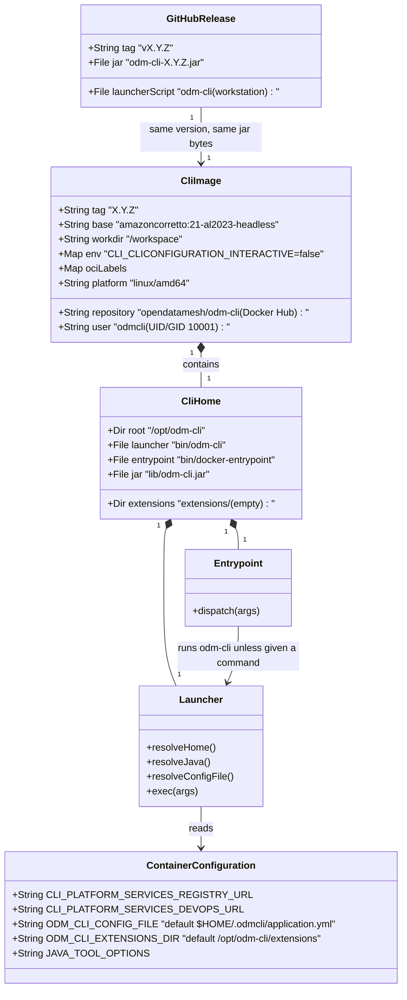

# ODM CLI Docker image for pipelines

_Revised on 2026-11-05 for the Docker analysis rev. 5 (PR #16 review and team call): Docker Hub, one tag, `linux/amd64`, no scan or smoke tests, no copyable bundle, instrumented tasks in separate jobs._

## Requirements

Publish, with every CLI release, a Docker image that runs the released CLI with the same commands, arguments and exit codes as the executable, so that pipelines can use the CLI without installing Java or the launcher script.

- **CI job image:** the image works as the job image of every job that calls the CLI, with no `entrypoint` override, in GitLab and in GitHub Actions. Instrumented tasks run `start-task` and `complete-task` in their own jobs, on the pipeline run id, so the user's build image is never changed (analysis D1, rev. 5).
- **Plain Docker:** `docker run <image> <odm-cli arguments>` behaves like `odm-cli <arguments>`.
- **Release integrity:** the image of version X contains exactly the jar attached to GitHub release X, and is published only after the existing release gate, like the other ODM services' images.
- **Boundaries:** no changes to the CLI's commands. Out of scope: a GitLab CI/CD Catalog component or GitHub Action, bundled extensions, image scanning, SBOM, provenance and signing, moving tags, arm64, images from `main`, the no-console NPE guard (D8), the stack-trace noise fix (D10). Per the analysis `spdd/analysis/BDMD-5443-202610270941-[Analysis]-cli-docker-image.md` (rev. 5).

## Entities

## Approach

1. **Packaging the released artifact**:
   - The image is built from the jar that `build-and-release-jar` built and attached, handed to the image job as a workflow artifact. No Maven build happens inside Docker, so no GitHub Packages credentials reach the build and the bytes are identical to the release asset.
   - Single stage on `amazoncorretto:21-al2023-headless`: Corretto 21, the distribution of the other platform services, on glibc Amazon Linux 2023. GitLab needs a shell in the job image, and GitHub container jobs need glibc for JavaScript actions. Alpine and distroless are excluded (analysis DD-01). The Java runtime is the base image's own, used through `JAVA_HOME`.
   - The CLI lives under `/opt/odm-cli`: launcher, entrypoint, jar under a version-independent name and an empty extensions directory.
   - The jar is started with `java -jar`, which goes through Spring Boot's `PropertiesLauncher` (`layout ZIP`), so `loader.path` keeps working for extensions.

2. **Launcher and entrypoint (POSIX `sh`, no Bash features)**:
   - `bin/odm-cli` replaces the workstation script inside the image: no Java check, no download, no cache, no GitHub API call. It resolves its own directory, uses `JAVA_HOME` (or `java` on `PATH`), passes the external configuration file and the extensions directory, and `exec`s the JVM with the arguments unchanged, so the exit code is the CLI's.
   - `bin/docker-entrypoint` is the image `ENTRYPOINT`. With no arguments, an option, or a top-level CLI command (`config`, `local`, `platform`) as first argument, it runs `odm-cli` with all arguments. When the first argument is another executable on `PATH` (GitLab passes `sh -c …`), it `exec`s that command. CI jobs therefore need no `entrypoint` override, and `docker run <image> <args>` still reaches the CLI.
   - `odm-cli` is on `PATH` (`/usr/local/bin/odm-cli` links to the launcher), so job scripts call `odm-cli …` as with the executable.

3. **Configuration in the container**:
   - Primary: environment variables, which Spring ranks above the configuration file (CI variables; credentials as masked variables or secrets, never in the CI file or the image). This is the CLI's general rule, documented in the README for every distribution.
   - Fallback file: `ODM_CLI_CONFIG_FILE`, default `$HOME/.odmcli/application.yml`, mirroring the workstation. The launcher creates it when the location is writable and passes it as `spring.config.additional-location=file:<path>` only when the file exists, so `config --set` works within a run (edits are lost unless the file is mounted) and a non-writable home never breaks startup.
   - Image defaults: `CLI_CLICONFIGURATION_INTERACTIVE=false`; nothing environment-specific. The packaged `application.yml` has no service URL either.
   - Proxies and JVM flags through `JAVA_TOOL_OPTIONS`; private CAs through a derived image that adds them to the system trust store (`/etc/pki/ca-trust/source/anchors/` and `update-ca-trust`), or through `JAVA_TOOL_OPTIONS` pointing `javax.net.ssl.trustStore` to a mounted store (documented).

4. **User and workspace**:
   - Non-root user `odmcli`, UID/GID 10001, home `/home/odmcli` (writable), `WORKDIR /workspace` owned by that user. Verified on GitLab with the Docker executor on 2026-11-03 (D4).

5. **Release and CI pipeline** (the pattern of the other ODM services):
   - `ci.yml` (push to `main`, PRs): job `image` builds the jar and the image locally with `docker build`. Nothing is pushed and nothing else runs on the image.
   - `cicd.yml` (release created): `build-and-release-jar` also uploads the jar as a workflow artifact; job `publish-image` (needs `build-and-release-jar`) downloads it, runs `docker build` with the version tag, logs in to Docker Hub with the `DOCKER_USERNAME`/`DOCKER_PASSWORD` secrets and runs `docker push`. Re-running it pushes the same tag from the same artifact.
   - Tag: the release tag without the `v` prefix, `X.Y.Z`. OCI labels: title, description, version, source repository, revision, licenses.

6. **Documentation**:
   - README "Run with Docker" subsection under Setup, linking `docs/run-with-docker.md` and `docs/devops-pipelines.md`; README "Environment variables" subsection under Configuration.
   - `docs/run-with-docker.md`: using the image (`docker run` with workspace mount, user, paths, no prompts, CI jobs), configuration (environment first, the file as fallback, image-only variables), extensions and certificates, exit codes, a short DevOps section linking the pipelines page.
   - `docs/devops-pipelines.md`: GitLab and GitHub examples with the CLI jobs in the image, the per-provider table and the cancel cases (functional slice).
   - `agents-reports/2.0.0-user-impacting-changes.md`: the published image, its name and the docs links.

## Structure

### Inheritance Relationships
1. No Java types are added. The image is a second distribution of the existing jar.
2. `CliImage` derives from `amazoncorretto:21-al2023-headless`; users' derived images (extensions, CA certificates) derive from `CliImage`.

### Dependencies
1. `Entrypoint` calls `Launcher` (`odm-cli`) or `exec`s the command it was given.
2. `Launcher` depends on `JAVA_HOME/bin/java` (falls back to `java` on `PATH`), `lib/odm-cli.jar`, the optional configuration file and the extensions directory.
3. The `Dockerfile` depends on `target/odm-cli-<version>.jar` and the `docker/` scripts; `.dockerignore` limits the build context to them.
4. `publish-image` depends on `build-and-release-jar` (jar artifact) and therefore on `verify-version` (tag/POM match, tests).

### Layered Architecture
1. **Build layer**: Maven builds the jar (unchanged); GitHub Actions moves it to the image job.
2. **Image layer**: `Dockerfile` assembles the base runtime, the CLI home, user, workdir, environment defaults and labels.
3. **Process layer**: `docker-entrypoint` → `odm-cli` launcher → JVM (`PropertiesLauncher`) → CLI.
4. **Verification layer**: the image build on every PR and `main` push; manual GitLab verification for the release that introduces the image.
5. **Distribution layer**: Docker Hub repository `opendatamesh/odm-cli`.

## Operations

### Create Build Context Filter - `.dockerignore`
1. Responsibility: keep the Docker build context to what the image needs.
2. Rules: exclude everything, then include `target/odm-cli-*.jar` and `docker/`.
3. Constraints: no source, `.git`, `.m2`, local configuration or test output enters the context.

### Create Launcher - `docker/odm-cli`
1. Responsibility: start the CLI inside the image, with arguments and exit code unchanged.
2. Logic:
   - Resolve `ODM_CLI_HOME` as the parent of the directory that contains the real launcher file (follow links, so `/usr/local/bin/odm-cli` resolves to `/opt/odm-cli`).
   - Java: `JAVA_HOME/bin/java` when executable; otherwise `java` from `PATH`; if neither exists, print "Error: Java runtime not found in JAVA_HOME or on PATH." to stderr and exit 1.
   - Configuration file: `ODM_CLI_CONFIG_FILE`, default `$HOME/.odmcli/application.yml`. When it does not exist, try to create its directory and the file with a single comment line, silently ignoring failure. When the file exists, add `-Dspring.config.additional-location=file:<path>`.
   - Extensions: `ODM_CLI_EXTENSIONS_DIR`, default `ODM_CLI_HOME/extensions`; when the directory exists, add `-Dloader.path=<dir>`.
   - `exec` the JVM with `-jar ODM_CLI_HOME/lib/odm-cli.jar` followed by `"$@"`. No `eval`, no word splitting of arguments, no network access, no output of its own on success.
3. Constraints: POSIX `sh`; executable bit set; paths with spaces are quoted.

### Create Entrypoint - `docker/docker-entrypoint`
1. Responsibility: make the image work both as a CI job image and with `docker run <image> <args>`.
2. Logic:
   - No arguments: `exec odm-cli` (prints the CLI usage).
   - First argument starts with `-`, or equals `config`, `local` or `platform`: `exec odm-cli "$@"`.
   - First argument is an executable found on `PATH` (`command -v`): `exec "$@"`.
   - Otherwise: `exec odm-cli "$@"`, so unknown commands get the CLI's own invalid-usage error and exit code 2.
3. Constraints: POSIX `sh`; the top-level command list matches the root command's subcommands and is updated when a top-level command is added.

### Create Image Definition - `Dockerfile` (repository root, like the other platform services)
1. Base: `amazoncorretto:21-al2023-headless`, single stage.
2. Build arguments: `VERSION`, `REVISION` (commit SHA), `JAR_FILE` (default `target/odm-cli-${VERSION}.jar`).
3. Steps:
   - Copy the jar to `/opt/odm-cli/lib/odm-cli.jar`, the launcher and the entrypoint to `/opt/odm-cli/bin/` with mode 0755.
   - In one layer: apply the available OS package updates (`dnf -y upgrade`) and clean the package cache; create `/opt/odm-cli/extensions`; link `/usr/local/bin/odm-cli` to the launcher; create group and user `odmcli` (UID/GID 10001, home `/home/odmcli`) by appending to `/etc/group` and `/etc/passwd` (the base has no `useradd`), and `/workspace` owned by it.
   - `ENV ODM_CLI_HOME=/opt/odm-cli`, `ENV CLI_CLICONFIGURATION_INTERACTIVE=false`.
   - OCI labels: `org.opencontainers.image.title=odm-cli`, `description`, `version=${VERSION}`, `revision=${REVISION}`, `source=https://github.com/opendatamesh-initiative/odm-cli`, `licenses`.
   - `USER 10001:10001`, `WORKDIR /workspace`, `ENTRYPOINT ["/opt/odm-cli/bin/docker-entrypoint"]`, no `CMD`.
4. Constraints: no secrets, URLs or configuration files baked in; no `EXPOSE`.

### Update CI Workflow - `.github/workflows/ci.yml`
1. Job `image` (needs `build`, `permissions: contents: read, packages: read`): checkout, JDK 21 (as `build`), Maven settings (as `build`), `mvn -B package -DskipTests`, read the project version, `docker build` with `VERSION` and `REVISION` into a local tag. No registry login, no push, no other step on the image.

### Update Release Workflow - `.github/workflows/cicd.yml`
1. `build-and-release-jar`: after building, upload `target/odm-cli-<version>.jar` as workflow artifact `odm-cli-jar` (`actions/upload-artifact`).
2. Job `publish-image` (needs `build-and-release-jar`; `permissions: contents: read`; `IMAGE_NAME: opendatamesh/odm-cli`):
   - Checkout; download artifact `odm-cli-jar` into `target/`.
   - Version: the release tag without its non-numeric prefix, as `verify-version` computes it.
   - `docker build . --file Dockerfile` with `VERSION` and `REVISION`, tagged `opendatamesh/odm-cli:<version>`.
   - Docker Hub login with `secrets.DOCKER_USERNAME` and `secrets.DOCKER_PASSWORD` (password on stdin), then `docker push opendatamesh/odm-cli:<version>`.
3. Constraints: the same steps and secrets as the other ODM services' `cicd.yml`; no Buildx, QEMU, `metadata-action`, scan or attestations.

### Update Documentation
1. `README.md`: "Run with Docker" subsection under Setup (one `docker run` example, links to `docs/run-with-docker.md` and `docs/devops-pipelines.md`); "Environment variables" subsection under Configuration (precedence, naming rule, table of the shared variables).
2. `docs/run-with-docker.md` (replaces `docs/docker.md`): the content listed in Approach 6, with the image-only variables `ODM_CLI_CONFIG_FILE`, `ODM_CLI_EXTENSIONS_DIR`, `JAVA_TOOL_OPTIONS`.
3. `agents-reports/2.0.0-user-impacting-changes.md`: the published image, its name and the docs links.

### Verify on GitLab (manual, before the first release with the image)
1. Build the image locally from the current jar and run the full-control and instrumented pipelines of the `gitLabDp` test project on the local runner (Docker executor):
   - full control: the results job with the image as job image;
   - instrumented: separate start, build and complete jobs on `$CI_PIPELINE_ID`, the CLI jobs with the image, the build job with its own image.
2. Check: the jobs succeed without `entrypoint` overrides; the CLI jobs read `build.log` and `results.json` from the build job's artifacts as UID 10001; DevOps records the same outcomes as in `agents-reports/BDMD-5443/e2e-local-tests.md`.
3. Record the outcome in `agents-reports/BDMD-5443/e2e-local-tests.md`. The GitHub examples are verified later.

### High-level tests (Gherkin)

Feature: The CLI is configured from outside the image
  Scenario: An environment variable wins over the configuration file
    Given the DevOps URL both in an environment variable and in the configuration file
    When the configuration is bound
    Then the URL of the environment variable is used

  Scenario: The configuration file is the fallback
    Given the Registry URL only in the configuration file
    When the configuration is bound
    Then the URL of the file is used

  Scenario: camelCase, nested and list keys bind from environment variables
    Given the DevOps tuning, OAuth2 credentials and a header set only as environment variables
    When the configuration is bound
    Then each value reaches its key

| Feature / Scenario | Test | Method |
| --- | --- | --- |
| The CLI is configured from outside the image / An environment variable wins over the configuration file | `OdmCliConfigurationEnvironmentTest` | `whenUrlIsInEnvironmentAndFileThenEnvironmentWins` |
| The CLI is configured from outside the image / The configuration file is the fallback | `OdmCliConfigurationEnvironmentTest` | `whenUrlIsOnlyInFileThenFileIsUsed` |
| The CLI is configured from outside the image / camelCase, nested and list keys bind from environment variables | `OdmCliConfigurationEnvironmentTest` | `whenNestedAndListKeysAreInEnvironmentThenTheyBind` |

The image itself has no automated tests (analysis DD-14, rev. 5): the PR build checks that it builds, and the GitLab verification above checks that it runs.

## Norms

1. **Configuration** ([`spdd/norms/CONFIGURATION.md`](../norms/CONFIGURATION.md)):
   - Externalised: URLs and credentials come from environment variables or a mounted file at run time; neither the image nor the packaged `application.yml` contains any.
   - Packaged defaults are safe and minimal: the only image default is `CLI_CLICONFIGURATION_INTERACTIVE=false`, correct in every container use.
   - No packaged collections: the image adds no lists (systems, headers, extensions) to the configuration.
   - Configuration selects behaviour: the launcher's behaviour varies only through `ODM_CLI_CONFIG_FILE`, `ODM_CLI_EXTENSIONS_DIR` and `JAVA_HOME`, never through environment-name checks.
2. **Testing** ([`spdd/norms/TESTING.md`](../norms/TESTING.md)): each Gherkin scenario maps to one named test whose documentation quotes it.
3. **Scripts**: POSIX `sh`, quoted expansions, no `eval`; errors to stderr with a message naming what is missing.
4. **Workflows**: follow the other ODM services' image steps and the existing workflow style; least-privilege `permissions` per job.
5. **Documentation**: English, examples pin `X.Y.Z` tags; README stays a short entry point and links the `docs/` pages.

## Safeguards

1. **Functional constraints**:
   - `docker run <image> <args>` and `odm-cli <args>` inside the image accept exactly the executable's arguments; the image adds or hides no commands.
   - The container exit status equals the CLI exit code (0, 1, 2); neither script remaps or swallows it.
   - A CI job using the image needs no `entrypoint` override.
2. **Release constraints**:
   - The image of version X contains the jar attached to release X (the workflow artifact of the same run), never a rebuilt one.
   - The image is pushed only after `verify-version` passed.
   - `X.Y.Z` is the only tag and is never overwritten by a different jar. No images from `main` or PRs are pushed.
3. **Security constraints**:
   - No credentials, tokens, URLs or configuration files in the image, its labels or its build context.
   - Runs as UID 10001.
   - Docker Hub credentials come only from the `DOCKER_USERNAME`/`DOCKER_PASSWORD` secrets, passed on stdin.
4. **Integration constraints**:
   - Corretto 21 from `amazoncorretto:21-al2023-headless`, `linux/amd64`.
   - The jar is started with `java -jar` so `PropertiesLauncher` and `loader.path` keep working.
   - The launcher never contacts the network; only the configured ODM services are contacted by the CLI.
   - The configuration file location is passed only when the file exists, with the `file:` prefix the `config` command expects.
5. **Behaviour constraints**:
   - The image never prompts: interactive mode is off by default and can be re-enabled only explicitly (`-e CLI_CLICONFIGURATION_INTERACTIVE=true` with `docker run -it`).
   - A missing or unwritable home does not prevent the CLI from starting.
6. **Technical constraints**:
   - No changes to the CLI commands or to the workstation `odm-cli` script.
   - Scripts are POSIX `sh` and work with the base image's shell.
7. **Documentation constraints**:
   - Every example pins an `X.Y.Z` tag.
   - The docs state that `~` and absolute paths refer to the container, and that `config` edits are lost unless the file is mounted.
