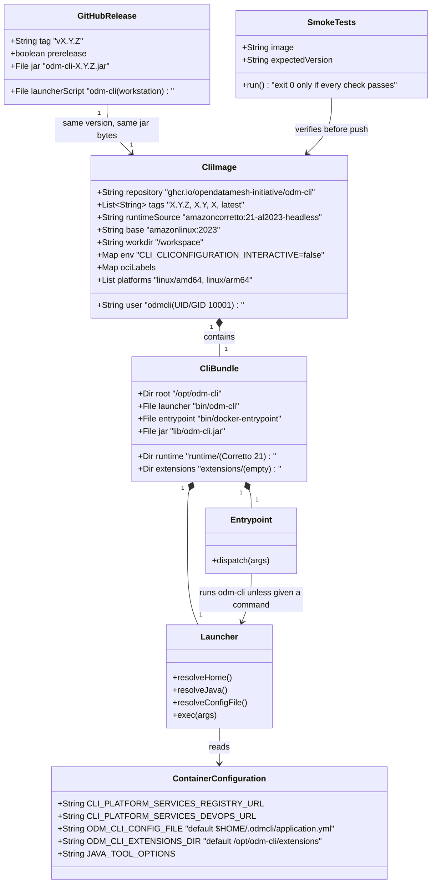

# ODM CLI Docker image for GitLab pipelines

## Requirements

Publish, with every CLI release, a Docker image that runs the released CLI with the same commands, arguments and exit codes as the executable, so that pipelines can use the CLI without installing Java or the launcher script.

- **GitLab first:** the image works as a GitLab job image for jobs that only call the CLI (full-control results upload, `platform registry validate`), with no `entrypoint` override. For instrumented jobs, which run `start-task`, the user's build and `complete-task` in one job, the image also ships a self-contained CLI bundle that users copy into their own glibc-based build image.
- **Plain Docker:** `docker run <image> <odm-cli arguments>` behaves like `odm-cli <arguments>`.
- **Release integrity:** the image of version X contains exactly the jar attached to GitHub release X, is published only after the existing release gate, and is scanned before it is pushed.
- **Boundaries:** no changes to the CLI's Java code or commands. Out of scope: GitHub Actions examples and tests (`docker://`, `container:`), a GitLab CI/CD Catalog component or GitHub Action, bundled extensions, cosign signing, scheduled rebuilds, images from `main`, the no-console NPE guard (D8), the stack-trace noise fix (D10) and the packaged sample values clean-up (D13). Those are separate fixes or later work, per the analysis `spdd/analysis/BDMD-5443-202610270941-[Analysis]-cli-docker-image.md` (rev. 3).

## Entities

## Approach

1. **Packaging the released artifact**:
   - The image is built from the jar that `build-and-release-jar` built and attached, handed to the image job as a workflow artifact. No Maven build happens inside Docker, so no GitHub Packages credentials reach the build and the bytes are identical to the release asset.
   - Java runtime: Corretto 21, the distribution of the other platform services, taken from the official `amazoncorretto:21-al2023-headless` image, the glibc Amazon Linux 2023 variant, because the bundle must run in users' glibc build images and GitLab needs a shell. Alpine and distroless are excluded (analysis DD-01).
   - Two-stage build: the first stage, on `amazoncorretto:21-al2023-headless`, copies the Corretto runtime into `/opt/odm-cli/runtime`; the final stage, on `amazonlinux:2023` (the same OS the Corretto image is built on, which already has the runtime's native libraries), copies that directory. Moving the runtime inside a single-stage Corretto image would keep the base layer's copy too: measured at 666 MB of uncompressed layers, against 413 MB for the two-stage image.
   - Everything the CLI needs lives under one directory, `/opt/odm-cli` (the bundle): launcher, entrypoint, jar under a version-independent name, Java runtime and an empty extensions directory. The image has a single Java runtime, `/opt/odm-cli/runtime`, which is `JAVA_HOME` and on `PATH`, so the image and the copied bundle use the same files. The base runtime's `lib/security/cacerts` is a link to the system trust store (`/etc/pki/java/cacerts`), which does not exist in other images, so it is replaced with a regular-file copy of that trust store: the bundle carries its own CA certificates, refreshed with every release.
   - The jar is started with `java -jar`, which goes through Spring Boot's `PropertiesLauncher` (`layout ZIP`), so `loader.path` keeps working for extensions.

2. **Launcher and entrypoint (POSIX `sh`, no Bash features)**:
   - `bin/odm-cli` replaces the workstation script inside containers: no Java check, no download, no cache, no GitHub API call. It resolves its own directory, prefers the bundled runtime, passes the external configuration file and the extensions directory, and `exec`s the JVM with the arguments unchanged, so the exit code is the CLI's.
   - `bin/docker-entrypoint` is the image `ENTRYPOINT`. With no arguments, an option, or a top-level CLI command (`config`, `local`, `platform`) as first argument, it runs `odm-cli` with all arguments. When the first argument is another executable on `PATH` (GitLab passes `sh -c …`), it `exec`s that command. GitLab jobs therefore need no `entrypoint: [""]`, and `docker run <image> <args>` still reaches the CLI.
   - `odm-cli` is on `PATH` (`/usr/local/bin/odm-cli` links to the bundle launcher), so GitLab job scripts call `odm-cli …` as with the executable.

3. **Configuration in the container**:
   - Primary: environment variables through Spring relaxed binding (GitLab CI/CD variables; credentials as masked variables, never in the CI file or the image).
   - Optional file: `ODM_CLI_CONFIG_FILE`, default `$HOME/.odmcli/application.yml`, mirroring the workstation. The launcher creates it when the location is writable and passes it as `spring.config.additional-location=file:<path>` only when the file exists, so `config --set` works within a run (edits are lost unless the file is mounted) and a non-writable home never breaks startup. The `optional:` prefix is not used because `config` writes to the location literally.
   - Image defaults: `CLI_CLICONFIGURATION_INTERACTIVE=false`; nothing environment-specific (no URLs, no credentials).
   - Proxies and JVM flags through `JAVA_TOOL_OPTIONS`, which the JVM reads itself; private CAs through a derived image that imports them into `/opt/odm-cli/runtime/lib/security/cacerts` with the bundled `keytool`, or through `JAVA_TOOL_OPTIONS` pointing `javax.net.ssl.trustStore` to a mounted store (documented).

4. **User and workspace**:
   - Non-root user `odmcli`, UID/GID 10001, home `/home/odmcli` (writable), `WORKDIR /workspace` owned by that user.
   - Gate: the GitLab Docker-executor test (Operations, "Verify on GitLab") must show that the instrumented job can write `build.log`, the marker file and `results.json` in the checkout with this user. If it cannot, the image switches to root and the reason is recorded in the analysis (D4). Verified on 2026-11-03: it can, so UID 10001 stays.

5. **Release and CI pipeline**:
   - `ci.yml` (push to `main`, PRs): a new job builds the jar and a single-architecture image locally, then runs the smoke tests. Nothing is pushed.
   - `cicd.yml` (release created): `build-and-release-jar` also uploads the jar as a workflow artifact; a new `publish-image` job (needs `build-and-release-jar`) downloads it, builds a local `linux/amd64` image, runs the smoke tests and a Trivy scan, then builds and pushes `linux/amd64` and `linux/arm64` with SBOM and provenance attestations. The job is idempotent and re-runnable: re-running it pushes the same tags from the same artifact.
   - Least privilege: only `publish-image` gets `packages: write`; it reads the repository with `contents: read`.
   - Tags from the release tag without the `v` prefix: `X.Y.Z` always; `X.Y`, `X` and `latest` only when the release is not a prerelease. OCI labels: title, description, version, source repository, revision, licenses.

6. **Documentation**:
   - README "Docker" subsection under Setup, linking `docs/docker.md`.
   - `docs/docker.md`: image name and tags (pin `X.Y.Z`), GitLab full-control job with the image as job image, GitLab instrumented job with the bundle copied into the build image (glibc requirement), `docker run` with workspace mount, configuration table, optional config file, non-interactive default, user and file ownership, extensions (derived image or mount), `JAVA_TOOL_OPTIONS` and CA certificates, exit codes.
   - The GitLab example in `docs/cmd-platform-devops-start-task.md` links to the Docker page for running it from the image.
   - `agents-reports/2.0.0-user-impacting-changes.md`: the Docker image moves from "planned" to shipped.

## Structure

### Inheritance Relationships
1. No Java types are added or changed. The image is a second distribution of the existing jar.
2. `CliImage` derives from `amazonlinux:2023` and takes its Java runtime from `amazoncorretto:21-al2023-headless`; users' derived images (extensions, CA certificates) derive from `CliImage`.
3. A user's build image includes `CliBundle` by copying `/opt/odm-cli` from `CliImage`.

### Dependencies
1. `Entrypoint` calls `Launcher` (`odm-cli`) or `exec`s the command it was given.
2. `Launcher` depends on `runtime/bin/java` (falls back to `java` on `PATH` when the bundled runtime is absent), `lib/odm-cli.jar`, the optional configuration file and the extensions directory.
3. The `Dockerfile` depends on `target/odm-cli-<version>.jar` and the `docker/` scripts; `.dockerignore` limits the build context to them.
4. `publish-image` depends on `build-and-release-jar` (jar artifact) and therefore on `verify-version` (tag/POM match, tests).
5. `docker/smoke-test.sh` depends on a built image and on the test descriptor `src/test/resources/org/opendatamesh/cli/usecases/descriptorvalidator/test_descriptorvalidator_data_product_descriptor.json`.

### Layered Architecture
1. **Build layer**: Maven builds the jar (unchanged); GitHub Actions moves it to the image job.
2. **Image layer**: `Dockerfile` assembles base runtime, bundle, user, workdir, environment defaults and labels.
3. **Process layer**: `docker-entrypoint` → `odm-cli` launcher → JVM (`PropertiesLauncher`) → CLI.
4. **Verification layer**: smoke tests on every build (PR, `main`, release), Trivy on release, manual GitLab verification for the release that introduces the image.
5. **Distribution layer**: GHCR repository `ghcr.io/opendatamesh-initiative/odm-cli`, public, linked to the GitHub repository.

## Operations

### Create Build Context Filter - `.dockerignore`
1. Responsibility: keep the Docker build context to what the image needs.
2. Rules: exclude everything, then include `target/odm-cli-*.jar` and `docker/`.
3. Constraints: no source, `.git`, `.m2`, local configuration or test output enters the context.

### Create Launcher - `docker/odm-cli`
1. Responsibility: start the CLI inside a container or a copied bundle, with arguments and exit code unchanged.
2. Logic:
   - Resolve `ODM_CLI_HOME` as the parent of the directory that contains the real launcher file (follow links, so `/usr/local/bin/odm-cli` resolves to `/opt/odm-cli`).
   - Java: `ODM_CLI_HOME/runtime/bin/java` when executable; otherwise `java` from `PATH`; if neither exists, print "Error: Java runtime not found in <ODM_CLI_HOME>/runtime or on PATH." to stderr and exit 1.
   - Configuration file: `ODM_CLI_CONFIG_FILE`, default `$HOME/.odmcli/application.yml`. When it does not exist, try to create its directory and the file with a single comment line, silently ignoring failure. When the file exists, add `-Dspring.config.additional-location=file:<path>`.
   - Extensions: `ODM_CLI_EXTENSIONS_DIR`, default `ODM_CLI_HOME/extensions`; when the directory exists, add `-Dloader.path=<dir>`.
   - `exec` the JVM with `-jar ODM_CLI_HOME/lib/odm-cli.jar` followed by `"$@"`. No `eval`, no word splitting of arguments, no network access, no output of its own on success.
3. Constraints: POSIX `sh`; executable bit set; paths with spaces are quoted.

### Create Entrypoint - `docker/docker-entrypoint`
1. Responsibility: make the image work both as a GitLab job image and with `docker run <image> <args>`.
2. Logic:
   - No arguments: `exec odm-cli` (prints the CLI usage).
   - First argument starts with `-`, or equals `config`, `local` or `platform`: `exec odm-cli "$@"`.
   - First argument is an executable found on `PATH` (`command -v`): `exec "$@"`.
   - Otherwise: `exec odm-cli "$@"`, so unknown commands get the CLI's own invalid-usage error and exit code 2.
3. Constraints: POSIX `sh`; the top-level command list matches the root command's subcommands and is updated when a top-level command is added.

### Create Image Definition - `Dockerfile` (repository root, like the other platform services)
1. Stages: `runtime` on `amazoncorretto:21-al2023-headless`; the final stage on `amazonlinux:2023`.
2. Build arguments: `VERSION`, `REVISION` (commit SHA), `JAR_FILE` (default `target/odm-cli-${VERSION}.jar`).
3. Steps:
   - Both stages first apply the available OS package updates (`dnf upgrade`) and clean the package cache in the same layer, so the image ships the fixed packages available at build time, including the current CA trust store copied into the bundle.
   - `runtime` stage: copy the Corretto Java home into `/opt/odm-cli/runtime`, resolving the real directory at build time rather than hard-coding it (it is architecture-specific, for example `java-21-amazon-corretto.x86_64`). Replace `runtime/lib/security/cacerts`, a link to the system trust store, with a regular-file copy of the store it resolves to.
   - Final stage: copy `/opt/odm-cli/runtime` from the `runtime` stage; create `/opt/odm-cli/{bin,lib,extensions}`; set `JAVA_HOME=/opt/odm-cli/runtime` and put `/opt/odm-cli/runtime/bin` on `PATH`.
   - Copy the jar to `/opt/odm-cli/lib/odm-cli.jar`, the launcher and the entrypoint to `/opt/odm-cli/bin/` with mode 0755; link `/usr/local/bin/odm-cli` to the launcher.
   - Create group and user `odmcli` (UID/GID 10001, home `/home/odmcli`), and `/workspace` owned by it. Add OS packages only when the base lacks the tool, and clean the package cache in the same layer.
   - `ENV CLI_CLICONFIGURATION_INTERACTIVE=false`; `ENV ODM_CLI_HOME=/opt/odm-cli`.
   - OCI labels: `org.opencontainers.image.title=odm-cli`, `description`, `version=${VERSION}`, `revision=${REVISION}`, `source=https://github.com/opendatamesh-initiative/odm-cli`, `licenses` (from the repository license).
   - `USER 10001:10001`, `WORKDIR /workspace`, `ENTRYPOINT ["/opt/odm-cli/bin/docker-entrypoint"]`, no `CMD`.
4. Constraints: no secrets, URLs or configuration files baked in; no `EXPOSE`; the bundle directory contains no absolute links pointing outside `/opt/odm-cli`.

### Create Smoke Tests - `docker/smoke-test.sh`
1. Responsibility: verify a built image before it is pushed; exit 0 only when every check passes, print each check's name and result, and on failure print the command output.
2. Arguments: image reference, expected version.
3. Checks (one function per Gherkin scenario below, named as in the table):
   - `checkVersion`: `docker run --rm IMAGE --version` exits 0 and its last output line equals the expected version.
   - `checkHelp`: `--help` exits 0 and lists `platform`.
   - `checkInvalidUsage`: `--no-such-option` exits 2.
   - `checkShellCommand`: `docker run --rm IMAGE sh -c 'odm-cli --version'` exits 0 with the expected version (the GitLab form).
   - `checkEnvironmentConfiguration`: with the test descriptor mounted read-only in a temporary workspace (`-v <dir>:/workspace`), `-e CLI_PLATFORM_SERVICES_REGISTRY_URL=http://odm-smoke-env.invalid:9999` and `platform registry validate -f <descriptor>`, exits 1 and the output names `odm-smoke-env.invalid`.
   - `checkMountedConfigurationFile`: same command with a mounted file at `/home/odmcli/.odmcli/application.yml` setting the registry URL to `http://odm-smoke-file.invalid:9999`, exits 1 and the output names `odm-smoke-file.invalid`.
   - `checkNonRootUser`: `docker run --rm IMAGE id -u` prints `10001`.
   - `checkNonInteractiveDefault`: `docker run --rm IMAGE sh -c 'echo $CLI_CLICONFIGURATION_INTERACTIVE'` prints `false`.
   - `checkCopiedBundle`: build a throw-away image from `debian:stable-slim` that copies `/opt/odm-cli` from IMAGE, then run `/opt/odm-cli/bin/odm-cli --version` in it: exits 0 with the expected version, and `/opt/odm-cli/runtime/lib/security/cacerts` is a non-empty regular file.
4. Constraints: POSIX `sh` plus Docker; no live external systems (`.invalid` hosts never resolve); temporary directories and throw-away images are removed on exit; the mounted workspace is world-readable so UID 10001 can read it.

### Update CI Workflow - `.github/workflows/ci.yml`
1. Add job `image` (needs `build`, `permissions: contents: read, packages: read`): checkout, JDK 21 (as `build`), Maven settings (as `build`), `mvn -B package -DskipTests`, read the project version, `docker build` with `VERSION` and `REVISION` into a local tag, run `docker/smoke-test.sh` against it. No registry login, no push.

### Update Release Workflow - `.github/workflows/cicd.yml`
1. `build-and-release-jar`: after building, upload `target/odm-cli-<version>.jar` as workflow artifact `odm-cli-jar` (`actions/upload-artifact`).
2. Add job `publish-image` (needs `build-and-release-jar`; `permissions: contents: read, packages: write`; the Buildx SBOM and provenance attestations are stored in the registry and need nothing more):
   - Checkout the release ref; download artifact `odm-cli-jar` into `target/`.
   - Version: the release tag without its non-numeric prefix, as `verify-version` computes it.
   - Set up QEMU and Buildx; log in to `ghcr.io` with `GITHUB_TOKEN`.
   - Tags (`docker/metadata-action`): `X.Y.Z` always; `X.Y`, `X` and `latest` only when `github.event.release.prerelease` is false.
   - Build `linux/amd64` into the local daemon with a local tag; run `docker/smoke-test.sh`; scan it with Trivy (`severity: CRITICAL`, `ignore-unfixed: true`, `exit-code: 1`).
   - Build and push `linux/amd64,linux/arm64` with the metadata tags and labels, `sbom: true`, `provenance: mode=max`.
3. Constraints: third-party actions pinned to a released major version, like the existing ones; the image repository name is lower case; no other job gains `packages: write`.

### Update Documentation
1. `README.md`: "Docker" subsection under Setup (pull, one `docker run` example, one GitLab job example, link to `docs/docker.md`).
2. `docs/docker.md`: the content listed in Approach 6, with the configuration table: `CLI_PLATFORM_SERVICES_REGISTRY_URL`, `CLI_PLATFORM_SERVICES_DEVOPS_URL`, `CLI_CLICONFIGURATION_INTERACTIVE`, `ODM_CLI_CONFIG_FILE`, `ODM_CLI_EXTENSIONS_DIR`, `JAVA_TOOL_OPTIONS`, and the `cli.platform.devops.*` tuning keys as `CLI_PLATFORM_DEVOPS_*`. GitLab examples:
   - full control: job `image: ghcr.io/opendatamesh-initiative/odm-cli:X.Y.Z`, script runs `odm-cli platform devops complete-task --provider-run-id "$CI_PIPELINE_ID" --results-only --results-file results.json`;
   - instrumented: the user's build image `COPY --from=ghcr.io/opendatamesh-initiative/odm-cli:X.Y.Z /opt/odm-cli /opt/odm-cli` plus `/opt/odm-cli/bin` on `PATH`, then the existing `start-task` / `after_script` `complete-task` job unchanged;
   - URLs and credentials as CI/CD variables, masked for secrets.
3. `docs/cmd-platform-devops-start-task.md`: one sentence under "GitLab CI example" linking to `docs/docker.md`.
4. `agents-reports/2.0.0-user-impacting-changes.md`: replace the "planned Docker image" note with the published image, its tags and the docs link.

### Verify on GitLab (manual, before the first release with the image)
1. Build the image locally from the current jar and run the full-control and instrumented jobs of the `gitLabDp` test project on the local runner (Docker executor):
   - full control with the image as job image;
   - instrumented with a build image that copies the bundle.
2. Check: both jobs succeed without `entrypoint` overrides; the instrumented job writes `build.log`, the marker and `results.json` as UID 10001; DevOps records the same outcomes as in `agents-reports/BDMD-5443/e2e-local-tests.md`.
3. Record the outcome in `agents-reports/BDMD-5443/e2e-local-tests.md`. If writing fails as non-root, switch the `Dockerfile` to root, update `checkNonRootUser`, and record the reason in the analysis (D4).

### High-level tests (Gherkin)

Feature: The image runs the released CLI
  Scenario: The image reports the release version
    Given an image built from the CLI jar of version X
    When the user runs the image with "--version"
    Then the output ends with "X" and the exit code is 0

  Scenario: Help is available
    When the user runs the image with "--help"
    Then the top-level commands are listed and the exit code is 0

  Scenario: Invalid usage keeps the CLI exit code
    When the user runs the image with an unknown option
    Then the exit code is 2

Feature: The image works as a GitLab job image
  Scenario: A shell command runs the CLI without an entrypoint override
    Given GitLab starts the job container with a shell command
    When the job script runs "odm-cli --version"
    Then the CLI prints the version and the exit code is 0

  Scenario: The bundle runs in another glibc image
    Given a build image that copies /opt/odm-cli from the CLI image
    When the job runs /opt/odm-cli/bin/odm-cli --version
    Then the CLI prints the version and the exit code is 0
    And the bundle carries its own CA certificates

Feature: The CLI is configured from outside the image
  Scenario: An environment variable sets the registry URL
    Given the variable CLI_PLATFORM_SERVICES_REGISTRY_URL points to an unreachable host
    When the user validates a descriptor in the mounted workspace
    Then the CLI fails with exit code 1 and names that host

  Scenario: A mounted configuration file sets the registry URL
    Given a configuration file mounted at the default location points the registry to an unreachable host
    When the user validates a descriptor in the mounted workspace
    Then the CLI fails with exit code 1 and names that host

  Scenario: The image never waits for input
    When the image starts without overrides
    Then interactive mode is off by default

Feature: The image follows the security decisions
  Scenario: The CLI runs as a non-root user
    When the user runs "id -u" in the image
    Then the output is 10001

| Feature / Scenario | Test | Check |
| --- | --- | --- |
| The image runs the released CLI / The image reports the release version | `docker/smoke-test.sh` | `checkVersion` |
| The image runs the released CLI / Help is available | `docker/smoke-test.sh` | `checkHelp` |
| The image runs the released CLI / Invalid usage keeps the CLI exit code | `docker/smoke-test.sh` | `checkInvalidUsage` |
| The image works as a GitLab job image / A shell command runs the CLI without an entrypoint override | `docker/smoke-test.sh` | `checkShellCommand` |
| The image works as a GitLab job image / The bundle runs in another glibc image | `docker/smoke-test.sh` | `checkCopiedBundle` |
| The CLI is configured from outside the image / An environment variable sets the registry URL | `docker/smoke-test.sh` | `checkEnvironmentConfiguration` |
| The CLI is configured from outside the image / A mounted configuration file sets the registry URL | `docker/smoke-test.sh` | `checkMountedConfigurationFile` |
| The CLI is configured from outside the image / The image never waits for input | `docker/smoke-test.sh` | `checkNonInteractiveDefault` |
| The image follows the security decisions / The CLI runs as a non-root user | `docker/smoke-test.sh` | `checkNonRootUser` |

Implement each check as a function in `docker/smoke-test.sh` whose leading comment copies its scenario verbatim.

## Norms

1. **Configuration** ([`spdd/norms/CONFIGURATION.md`](../norms/CONFIGURATION.md)):
   - Externalised: URLs and credentials come from environment variables or a mounted file at run time; the image packages none.
   - Packaged defaults are safe and minimal: the only image default is `CLI_CLICONFIGURATION_INTERACTIVE=false`, correct in every container use.
   - No packaged collections: the image adds no lists (systems, headers, extensions) to the configuration.
   - Configuration selects behaviour: the launcher's behaviour varies only through `ODM_CLI_CONFIG_FILE`, `ODM_CLI_EXTENSIONS_DIR` and the presence of the bundled runtime, never through environment-name checks.
2. **Testing** ([`spdd/norms/TESTING.md`](../norms/TESTING.md)):
   - Traceability: each Gherkin scenario maps to one named check whose comment quotes it.
   - Isolation: checks use no live external systems (`.invalid` hosts), no developer-local configuration, and no execution order; each check creates and removes its own temporary state.
   - The image checks are neither `*Test` nor `*IT`: they verify a built artifact, run outside Maven, in the CI and release workflows. The Java suites stay unchanged and still gate the release through `verify-version`.
3. **Scripts**: POSIX `sh`, `set -eu` where it does not interfere with capturing exit codes, quoted expansions, no `eval`; errors to stderr with a message naming what is missing.
4. **Workflows**: follow the existing workflow style (job names, `actions/setup-java` with Temurin for the Maven build, the Maven settings step for GitHub Packages); least-privilege `permissions` per job.
5. **Documentation**: English, examples pin `X.Y.Z` tags, GitLab first; README stays a short entry point and links the `docs/` page.

## Safeguards

1. **Functional constraints**:
   - `docker run <image> <args>` and `odm-cli <args>` inside the image accept exactly the executable's arguments; the image adds or hides no commands.
   - The container exit status equals the CLI exit code (0, 1, 2); neither script remaps or swallows it.
   - A GitLab job using the image needs no `entrypoint` override.
   - The bundle under `/opt/odm-cli` runs after being copied into another glibc-based image, with no links or files outside that directory, including the CA trust store.
2. **Release constraints**:
   - The image of version X contains the jar attached to release X (the workflow artifact of the same run), never a rebuilt one.
   - The image is pushed only after `verify-version` passed and the smoke tests and the Trivy scan passed in the same job.
   - `X.Y.Z` is never overwritten by a different jar; `X.Y`, `X` and `latest` move only for non-prerelease releases. No images from `main` or PRs are pushed.
3. **Security constraints**:
   - No credentials, tokens, URLs or configuration files in the image, its labels or its build context.
   - Runs as UID 10001 unless the GitLab verification forces root, which is then documented with its reason.
   - Only `publish-image` has `packages: write`; registry login uses `GITHUB_TOKEN`.
   - The release fails on fixable critical vulnerabilities found by Trivy.
4. **Integration constraints**:
   - Corretto 21 runtime from `amazoncorretto:21-al2023-headless` on an `amazonlinux:2023` base, multi-arch `linux/amd64` and `linux/arm64`.
   - The jar is started with `java -jar` so `PropertiesLauncher` and `loader.path` keep working.
   - The launcher never contacts the network; only the configured ODM services are contacted by the CLI.
   - The configuration file location is passed only when the file exists, with the `file:` prefix the `config` command expects.
5. **Behaviour constraints**:
   - The image never prompts: interactive mode is off by default and can be re-enabled only explicitly (`-e CLI_CLICONFIGURATION_INTERACTIVE=true` with `docker run -it`).
   - A missing or unwritable home does not prevent the CLI from starting.
6. **Technical constraints**:
   - No changes to Java code, `pom.xml` or the workstation `odm-cli` script.
   - Scripts are POSIX `sh` and work with the base image's shell and with `debian:stable-slim`.
   - Third-party GitHub actions are pinned to released major versions.
7. **Documentation constraints**:
   - Every example pins an `X.Y.Z` tag; moving tags are mentioned only as a convenience.
   - The docs state the glibc requirement for the copied bundle, that `~` and absolute paths refer to the container, and that `config` edits are lost unless the file is mounted.
